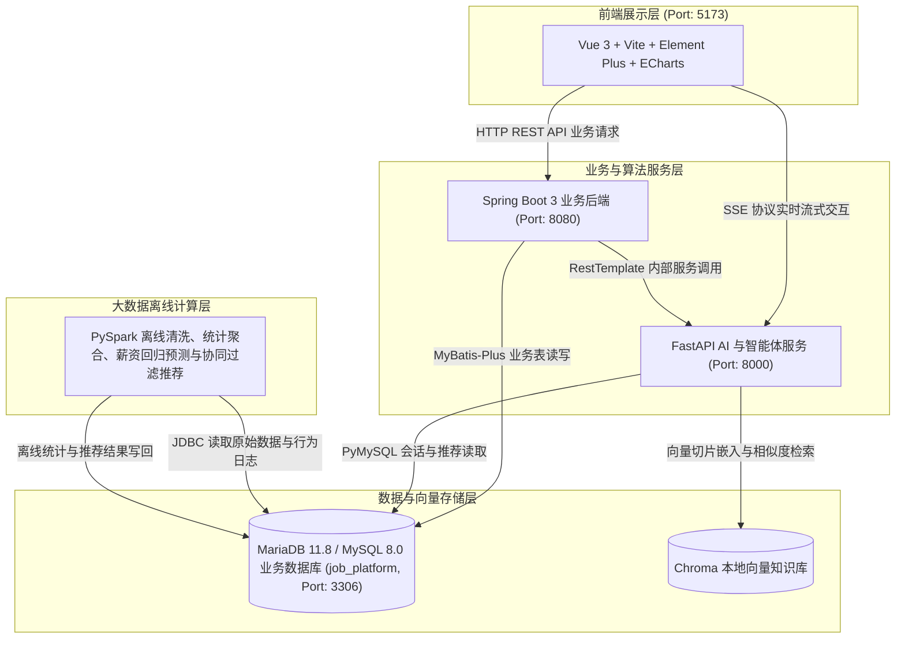

# 基于Spark与RAG的高校就业推荐平台的设计与实现

本项目为毕业设计课题 **《基于Spark与RAG的高校就业推荐平台的设计与实现》** 的核心工程代码库，项目根目录为 `/workspace/bishe`。平台采用分布式微服务与模块化设计理念，融合大数据离线分析、推荐算法、向量知识库检索与生成式多角色 AI 智能体技术，为高校毕业生、招聘企业及学校管理人员提供全流程智能化招聘与就业推荐服务。

---

## 1. 项目简介

### 1.1 系统角色划分
平台面向三类核心使用角色，并提供定制化的业务功能与权限控制：
1. **学生（Student）**：维护求职基本档案与掌握技能、创建多份在线简历、多条件搜索与筛选职位、收藏职位、投递职位并跟踪投递状态机流转、接收面试日程提醒、查看个人技能雷达图、在面经社区互动交流，并通过学生求职辅导智能体获得基于 RAG 与推荐算法的求职建议与职位匹配。
2. **企业（Company）**：完善企业基本信息与营业执照资质认证、发布与管理招聘职位（设置技术方向、薪资区间、学历要求、技能标签、上下架状态）、筛选候选人投递、执行投递状态机流转（初筛/笔试/面试/录用/淘汰）、排期面试日程、查看招聘漏斗与候选人学历分布图表、使用企业招聘助手智能体优化岗位要求。
3. **管理员（Admin）**：全平台统一管理，包括账号状态审核、企业资质认证审核、职位合规性审核、面经与评论社区内容审查；发布双选会公告与国家就业政策；管理职位分类树与技能标签；监控宏观就业可视化大屏（全国岗位热力图、技术需求趋势、城市薪资排行）；调用管理端智能体进行全局统计分析。

### 1.2 核心业务与技术模块
系统划分为五大核心功能模块：
1. **基础业务与统一认证模块**：学生/企业资料维护与资质审核、系统首页轮播图、双选会公告、就业政策与资讯发布、面经与企业评价社区（带评分与跟评）、管理员审核流（账号/企业/职位/评论）、层级职位分类与技术技能标签字典体系。
2. **招聘流程与状态机管理模块**：企业职位发布（支持技术方向、月薪区间、学历与经验限制、关联技能标签、上下架控制）、学生端多条件动态检索（支持方向、城市、薪资区间重叠、学历门槛、最新发布排序）、职位收藏、在线简历管理；投递状态机引擎（`待初筛` → `笔试` → `面试中` → `已录用 / 未通过`）及状态变更日志记录、面试日程安排与提前到期提醒。
3. **ECharts 多维度可视化模块**：
   - 学生侧：个人掌握技能与岗位要求的五维技能雷达图；
   - 企业侧：岗位招聘转化漏斗图、应聘学生学历构成饼图/柱状图；
   - 管理端：全国高校就业岗位与薪资分布中国热力图、热门技术月度需求趋势折线图、全国各城市/技术方向薪资排行柱状图、实时职位技能词云。
4. **PySpark 大数据离线分析与推荐引擎模块**：利用 PySpark 进行海量招聘岗位与历史投递日志的离线数据清洗、特征抽取与聚合计算；训练薪资回归预测模型；实现基于学生历史行为矩阵（浏览、收藏、投递加权）的 User-CF 协同过滤算法以及基于掌握技能与岗位标签的内容匹配算法，形成混合推荐得分并将结果批量回写至 MySQL 业务库。
5. **RAG 向量知识库与多角色智能体模块**：集成 Chroma 向量数据库与 LangChain 框架，切片并向量化嵌入就业政策、校招指南、高频面经与企业信息；针对学生、企业、管理员提供专用 AI 智能体，后端基于 FastAPI 实现 Server-Sent Events (SSE) 协议的高性能流式文本与推理思考过程实时推送。

---

## 2. 系统架构图

系统采用现代分层架构：前端 Vue 3（端口 5173）通过 RESTful API 与业务后端 Spring Boot（端口 8080）交互，并通过 SSE 长连接直连 FastAPI（端口 8000）获取流式生成式 AI 响应；Spring Boot 业务服务通过 `RestTemplate` 同步调用 FastAPI 推荐与算法接口；Spring Boot、FastAPI 与 PySpark 统一读写 MariaDB/MySQL（`job_platform`）；FastAPI 读写本地持久化的 Chroma 向量库；PySpark 周期性拉取日志计算后批量写回 MySQL 供业务展示。



---

## 3. 技术栈清单

| 分层领域 | 技术组件 / 框架 | 版本要求 | 用途说明 |
| :--- | :--- | :--- | :--- |
| **前端工程** | Vue.js | 3.5+ | 核心前端框架（Composition API） |
| | Vite | 6.2+ | 前端构建与本地开发服务器 |
| | Element Plus | 2.9+ | 企业级 UI 组件库 |
| | ECharts | 5.6+ | 数据可视化图表（雷达图、漏斗图、热力图、词云） |
| | Pinia | 2.3+ | 前端全局状态管理 |
| | Vue Router | 4.5+ | 单页面路由管理 |
| | Axios | 1.7+ | HTTP 客户端 |
| **业务后端** | Java / JDK | 21 (LTS) | 核心编程语言与虚拟线程运行环境 |
| | Spring Boot | 3.3.5 | 核心业务服务框架 |
| | MyBatis-Plus | 3.5.7 | 数据持久层 ORM 与代码简化 |
| | RestTemplate | 内置 | 跨服务 HTTP 客户端，调用 FastAPI 算法接口 |
| | MySQL Connector/J | 8.x | MySQL / MariaDB JDBC 连接驱动 |
| | Lombok | 1.18+ | 简化 Java Bean 样板代码 |
| | Maven | 3.9+ | 后端依赖管理与工程构建工具 |
| **AI 与大数据** | Python | 3.12+ | 算法、推荐与智能体运行语言 |
| | FastAPI | 0.115+ | 高性能异步 Web 框架与 SSE 推送 |
| | Uvicorn | 0.34+ | ASGI 异步服务器 |
| | LangChain | 0.3+ | 大语言模型与 RAG 智能体工作流编排 |
| | ChromaDB | 0.6+ | 本地向量数据库，提供向量索引与召回 |
| | PySpark | 3.5+ | 大数据离线清洗、特征工程与推荐计算 |
| | PyMySQL | 1.1+ | Python 异步/同步 MySQL 连接驱动 |
| **数据与存储** | MariaDB / MySQL | 11.8+ / 8.0+ | 关系型业务主库（字符集 `utf8mb4`） |
| | Chroma Store | 本地嵌入式 | 知识库切片向量数据持久化 |

---

## 4. 目录结构说明

```
/workspace/bishe/
├── backend/                      # Spring Boot 业务后端工程 (端口 8080)
│   ├── src/main/java/com/bishe/job/
│   │   ├── client/               # 跨服务客户端 (FastApiClient 等)
│   │   ├── common/               # 统一响应封装 (Result)、业务异常 (BusinessException)、全局异常处理
│   │   ├── config/               # 跨域 CORS、RestTemplate 等配置
│   │   ├── controller/           # 业务 REST 控制器 (如 HealthController 等)
│   │   ├── mapper/               # MyBatis-Plus Mapper 接口
│   │   └── JobApplication.java   # Spring Boot 启动入口
│   ├── src/main/resources/
│   │   └── application.yml       # 后端配置文件 (数据源、端口、FastAPI 地址)
│   └── pom.xml                   # Maven 构建文件
├── ai-service/                   # FastAPI AI 算法与多角色智能体工程 (端口 8000)
│   ├── app/
│   │   ├── api/                  # 接口路由层 (health, spark, recommend, rag, agent)
│   │   ├── core/                 # 配置中心 (config.py)、统一 Result 响应封装 (response.py)
│   │   ├── services/             # 业务逻辑与算法实现 (spark, recommend, rag, agent)
│   │   └── main.py               # FastAPI 应用入口、CORS、全局异常与路由注册
│   ├── .env.example              # 环境变量示例模板
│   ├── requirements.txt          # Python 依赖清单
│   └── README.md                 # AI 服务专项详细文档
├── frontend/                     # Vue 3 前端工程 (端口 5173)
│   ├── src/
│   │   ├── api/                  # Axios 封装与后端 / AI 接口定义
│   │   ├── components/           # 通用可复用组件
│   │   ├── layouts/              # 页面母版与布局组件
│   │   ├── router/               # 路由表定义
│   │   ├── stores/               # Pinia 响应式状态库
│   │   ├── utils/                # 工具函数 (格式化、网络请求、SSE 连接器)
│   │   ├── views/                # 各角色页面视图 (学生、企业、管理员、可视化大屏)
│   │   ├── App.vue               # 根组件
│   │   └── main.js               # 前端入口文件
│   ├── .env.development          # 前端开发环境变量 (VITE_API_BASE, VITE_AI_BASE)
│   ├── package.json              # 前端依赖配置
│   └── vite.config.js            # Vite 构建与服务代理配置
├── db/                           # 数据库脚本与设计文档
│   ├── schema.sql                # 27 张完整表结构定义 (包含外键、检查约束、索引与注释)
│   ├── seed.sql                  # 初始化种子数据与演示账号
│   └── README.md                 # 数据库设计文档与完整 ER 图说明
├── scripts/                      # 基础运维与自动化脚本
│   └── start-mysql.sh            # MariaDB 守护进程启动与自愈检查脚本
├── .gitignore                    # Git 忽略配置
└── README.md                     # 项目综合说明主文档
```

---

## 5. 端口与通信协议

| 组件 / 服务 | 监听端口 | 通信协议 | 访问 URL | 作用 |
| :--- | :--- | :--- | :--- | :--- |
| **Frontend** | `5173` | HTTP | `http://localhost:5173` | Vue 3 单页面前端交互界面 |
| **Backend** | `8080` | HTTP | `http://localhost:8080` | Spring Boot 业务接口服务 |
| **AI Service** | `8000` | HTTP / SSE | `http://localhost:8000` | FastAPI 算法、推荐、RAG 与智能体服务 |
| **MariaDB / MySQL** | `3306` | TCP / MySQL | `127.0.0.1:3306` | `job_platform` 业务数据库与离线数据表 |
| **Chroma** | 本地目录 | 嵌入式驱动 | `./ai-service/data/chroma` | 向量索引与持久化存储 |

---

## 6. 环境要求

在运行平台各服务前，请确保操作系统中已具备以下基础软件环境：
- **Java 运行环境**：OpenJDK 21 或更高版本（必须配置环境变量 `JAVA_HOME=/usr/lib/jvm/java-21-openjdk-amd64`）。
- **Maven 构建工具**：Apache Maven 3.9.x。
- **数据库服务**：MariaDB 11.8+ 或 MySQL 8.0+，字符集采用 `utf8mb4`。
- **Node.js 与包管理器**：Node.js 24+，以及 `pnpm` 包管理工具。
- **Python 环境**：Python 3.12+ 虚拟环境，位于 `/workspace/bishe/.venv`（已集成 FastAPI, Uvicorn, PySpark, LangChain, ChromaDB, PyMySQL 等库）。

---

## 7. 各部分运行步骤

### 7.1 数据库初始化与启动
1. **启动 MariaDB 数据库服务**：
   ```bash
   bash scripts/start-mysql.sh
   ```
2. **初始化表结构与种子数据**：
   ```bash
   mariadb -h127.0.0.1 -ujob -pjob123 job_platform < db/schema.sql
   mariadb -h127.0.0.1 -ujob -pjob123 job_platform < db/seed.sql
   ```
3. **预设演示账号**：
   | 用户名 | 明文密码 | 角色 | 说明 |
   | :--- | :--- | :--- | :--- |
   | `admin` | `admin123` | 管理员 | 系统管理、审核中心与宏观数据大屏 |
   | `student` | `student123` | 学生 (陈晓) | 求职搜索、在线简历、职位投递与雷达图 |
   | `company` | `company123` | 企业 (星澜科技) | 职位发布、候选人筛选与面试日程管理 |

   > 更多数据库设计、字段字典及表关系，详见 [db/README.md](file:///workspace/bishe/db/README.md)。

---

### 7.2 业务后端服务启动 (Spring Boot)
1. **设置 Java 21 环境并编译打包**：
   ```bash
   export JAVA_HOME=/usr/lib/jvm/java-21-openjdk-amd64
   cd /workspace/bishe/backend
   mvn -DskipTests package
   ```
2. **启动 Spring Boot 服务**：
   ```bash
   java -jar target/job-backend-1.0.0.jar
   ```
3. **健康检查验证**：
   ```bash
   curl http://localhost:8080/api/health
   ```
   预期响应：`{"code":200,"msg":"Backend service is running normally","data":{"status":"UP",...}}`

---

### 7.3 AI 算法与智能体服务启动 (FastAPI)
1. **准备环境变量配置**：
   ```bash
   cd /workspace/bishe/ai-service
   cp .env.example .env
   ```
2. **通过已就绪的虚拟环境启动 Uvicorn 服务**：
   ```bash
   ../.venv/bin/uvicorn app.main:app --host 0.0.0.0 --port 8000
   ```
3. **健康检查与 SSE 流式输出测试**：
   ```bash
   # 健康检查
   curl http://localhost:8000/health

   # SSE 流式响应测试 (实时输出思考与推理过程)
   curl -N "http://localhost:8000/agent/stream-demo?q=你好"
   ```

---

### 7.4 前端应用启动 (Vue 3)
1. **安装依赖并启动 Vite 开发服务器**：
   ```bash
   cd /workspace/bishe/frontend
   pnpm install
   pnpm dev
   ```
   服务将监听 `http://localhost:5173`，浏览器直接访问即可进入系统。
2. **生产构建打包**：
   ```bash
   pnpm build
   ```
   构建产物将输出至 `frontend/dist/` 目录。

---

## 8. 统一数据交互规范

为保障前端、Spring Boot 业务后端与 FastAPI 算法服务三端协同的一致性，系统全域采用标准统一响应格式：

```json
{
  "code": 200,
  "msg": "操作成功",
  "data": {}
}
```

- **`code`**：业务状态码。`200` 代表请求执行成功，其余状态码（如 `400` 参数错误、`401` 未授权、`403` 权限不足、`500` 系统内部异常）代表各层级捕获的业务逻辑异常。
- **`msg`**：操作结果提示信息或错误异常描述。
- **`data`**：业务返回的主体数据对象（支持基础类型、实体对象、列表集合及分页结构）。

---

## 9. 项目开发路线图 (Roadmap)

- [x] **Phase 1: 数据库设计与三端基础工程建设（已完成）**
  - 完成 27 张核心业务表结构设计、外键规范、索引优化与初始种子数据迁移（`schema.sql`、`seed.sql`）。
  - 完成 Spring Boot 3 + Java 21 后端工程脚手架，集成 MyBatis-Plus、RestTemplate、CORS、统一响应与全局异常处理器。
  - 完成 FastAPI 异步 AI 服务脚手架，实现统一响应拦截、Pydantic 配置管理、健康检查与 SSE 流式输出原型。
  - 完成 Vue 3 + Vite + Element Plus + Pinia + ECharts 前端工程搭建与双端 API 代理打通。
- [ ] **Phase 2: 基础业务与认证授权体系**
  - 实现基于 JWT / Spring Security 的学生、企业、管理员统一账号认证与鉴权。
  - 实现学生档案、企业资料与资质审核流。
  - 实现首页轮播图、双选会公告、就业政策 CMS 资讯模块。
  - 实现面经与企业评价社区及管理员审核机制。
- [ ] **Phase 3: 招聘业务流程与状态机闭环**
  - 实现企业端职位发布（技术方向、薪资区间、学历要求、技能打标与上下架状态切换）。
  - 实现学生端职位多条件重叠过滤与组合检索（城市、方向、薪资区间、学历、最新发布排序）。
  - 实现在线简历多版本管理与一键投递。
  - 落地投递状态机驱动引擎（`待初筛` → `笔试` → `面试中` → `已录用 / 未通过`）及审计流转日志。
  - 实现面试日程创建与提前预约提醒。
- [ ] **Phase 4: 多角色 ECharts 数据可视化分析**
  - 学生端：个人技能图谱与岗位匹配五维雷达图。
  - 企业端：招聘漏斗分析图与应聘者学历分布统计图。
  - 管理员端：全国高校就业热力图、热门技术月度需求趋势图、薪资排行柱状图与实时岗位技能词云。
- [ ] **Phase 5: PySpark 离线大数据计算与推荐引擎**
  - 编写 PySpark 离线批处理作业，对职位库与行为日志清洗、特征工程提取与聚合。
  - 构建薪资回归预测模型。
  - 实现基于加权用户行为日志（浏览 1 / 收藏 3 / 投递 5）的 User-CF 协同过滤算法。
  - 实现基于技能标签的内容匹配算法，完成融合打分并批量写回 MySQL 推荐表。
- [ ] **Phase 6: RAG 向量知识库与多角色智能体**
  - 接入 Chroma 向量数据库，实现就业政策与面经切片向量化与相似度召回。
  - 基于 LangChain 构建多角色 Prompt 模板与智能体（学生端求职教练、企业端岗位顾问、管理员端分析助手）。
  - 完善 FastAPI SSE 协议流式输出与前端 Markdown / 思考链展示组件深度联动。
