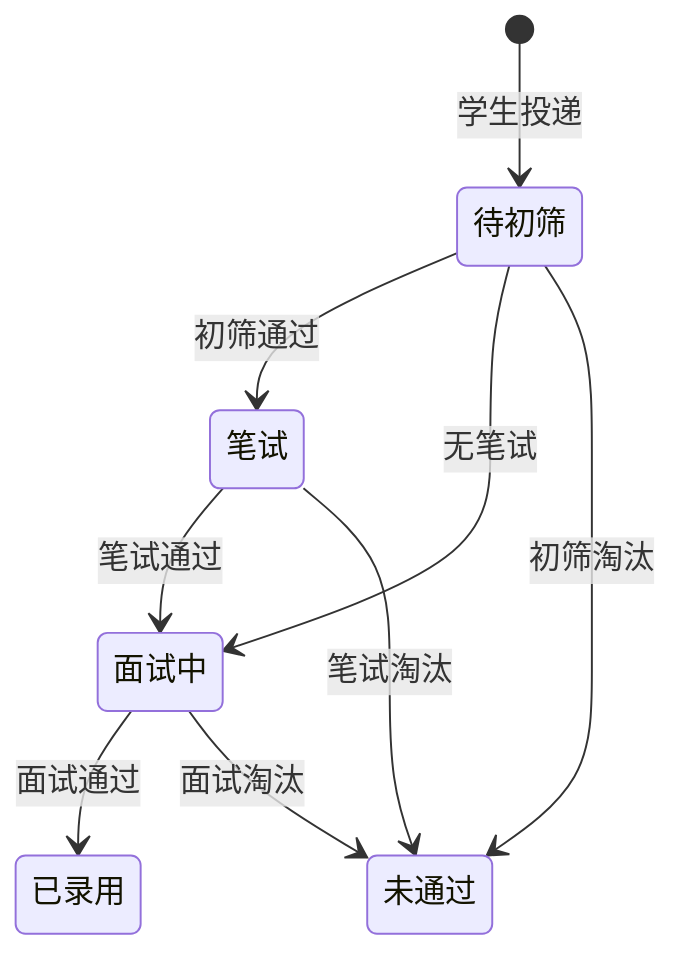

# job_platform 数据库设计

高校就业推荐平台的 MySQL 库（MariaDB 11.8，MySQL 协议）。业务库由 Spring Boot 读写，PySpark 把离线结果写回本库，RAG 原文放在 `rag_document`，向量放在 Chroma。

字符集 `utf8mb4` / `utf8mb4_unicode_ci`，引擎 InnoDB。28 张表都有中文表注释和字段注释，并包含 `create_time`、`update_time`、`deleted`（0 否，1 是）。

## 初始化

账号 `job` 只有 `job_platform.*` 的权限，不能 `CREATE DATABASE`。库已存在时直接执行：

```bash
mariadb -h127.0.0.1 -ujob -pjob123 < schema.sql
mariadb -h127.0.0.1 -ujob -pjob123 < seed.sql
```

`schema.sql` 会按依赖逆序 `DROP TABLE IF EXISTS` 再重建，可重复执行。`seed.sql` 在事务里先清空再插入，也可单独重复执行。已有库只扩展 RAG 字段时执行 `db/migrations/phase5_rag.sql`（可重复执行，不删业务数据）。

空库需要由管理员先建库（应用账号不必执行）：

```sql
CREATE DATABASE IF NOT EXISTS job_platform
  DEFAULT CHARACTER SET utf8mb4
  DEFAULT COLLATE utf8mb4_unicode_ci;
```

演示账号（明文只写在 `seed.sql` 注释里，库内是 BCrypt，可用 Spring Security `BCryptPasswordEncoder` 校验）：

| 用户名 | 明文密码 | 角色 |
| --- | --- | --- |
| admin | admin123 | 管理员 |
| student | student123 | 学生陈晓 |
| company | company123 | 星澜科技 |

Spark 结果行是按这两条职位手工填的占位数据，正式环境由 PySpark 按 `batch_no` 覆盖，并把旧批次的 `is_latest` 置 0。

## 表清单

| 表 | 用途 |
| --- | --- |
| sys_user | 学生、企业、管理员统一登录账号与账号审核 |
| stu_profile | 学生档案：学校、学历、期望城市与薪资 |
| stu_skill | 学生技能及 1–5 熟练度，供技能雷达图 |
| ent_company | 企业资料、营业执照与资质审核 |
| stu_resume | 在线简历，一名学生可有多份，一份默认 |
| job_category | 职位分类树，管理员维护 |
| skill_tag | 技能标签，并带技术方向 |
| job_position | 职位：技能方向、城市、薪资区间、学历、上下架与审核 |
| job_position_tag | 职位与技能标签的多对多关联 |
| job_favorite | 学生对职位的收藏 |
| job_application | 简历投递及当前状态 |
| job_application_log | 投递状态变更日志，记录每次状态机迁移 |
| job_interview | 面试日程，含提前量、提醒状态和实际提醒时间 |
| com_post | 面经与企业评价，带审核状态 |
| com_comment | 帖子下的评论，供管理员审核 |
| cms_article | 双选会公告、就业政策、新闻资讯 |
| cms_banner | 首页轮播图 |
| user_behavior_log | 浏览、收藏、投递行为，供 User-CF |
| spark_salary_stat | 按城市和技术方向的薪资统计 |
| spark_tech_trend | 按月的技术需求趋势，供趋势图和词云 |
| spark_region_dist | 省级职位与薪资分布，供中国热力图 |
| spark_salary_predict | 薪资回归预测结果 |
| spark_recommend | User-CF、内容匹配、融合推荐及匹配分 |
| spark_recommend_eval | 推荐离线评估：Precision/Recall/NDCG@K 与目录覆盖率 |
| spark_task_log | Spark 任务批次、状态、行数和错误信息 |
| rag_document | RAG 知识切片；向量在 Chroma，这里记 `chroma_id` |
| ai_session | 学生、企业或管理员智能体的会话 |
| ai_message | 会话消息；助手消息保存 SSE 结束后的全文，`extra` 为来源与工具的 JSON 文本 |

图表取数：技能雷达读 `stu_skill`；企业漏斗按 `job_application.status` 聚合；学历分布用投递关联 `stu_profile.education`；热力图、技术趋势、薪资排行读对应 Spark 表中 `is_latest = 1 AND deleted = 0` 的行。词云可用 `spark_tech_trend` 的最新月，也可用在招职位的 `job_position_tag` 实时计数。

## ER 图

实线表示业务关系。`user_behavior_log`、六张 Spark 结果表、`spark_task_log`、`rag_document.source_id` 在库里是逻辑关联（有索引、无 `FOREIGN KEY`），图中仍然画出，便于看数据从哪来。审核人 `auditor_id` 都指向 `sys_user`，图中不逐条展开。

```mermaid
erDiagram
  sys_user ||--o| stu_profile : "学生档案"
  sys_user ||--o| ent_company : "企业账号"
  sys_user ||--o{ stu_resume : "在线简历"
  sys_user ||--o{ stu_skill : "掌握技能"
  skill_tag ||--o{ stu_skill : "技能标签"
  sys_user ||--o{ job_favorite : "收藏"
  sys_user ||--o{ job_application : "投递"
  sys_user ||--o{ job_application_log : "操作"
  sys_user ||--o{ com_post : "发帖"
  sys_user ||--o{ com_comment : "评论"
  sys_user ||--o{ cms_article : "发布"
  sys_user ||--o{ ai_session : "会话"
  sys_user ||--o{ user_behavior_log : "行为"
  sys_user ||--o{ spark_recommend : "被推荐"

  job_category |o--o{ job_category : "上级"
  job_category ||--o{ job_position : "分类"
  ent_company ||--o{ job_position : "发布职位"
  job_position ||--o{ job_position_tag : "打标签"
  skill_tag ||--o{ job_position_tag : "被引用"
  job_position ||--o{ job_favorite : "被收藏"
  job_position ||--o{ job_application : "收到投递"
  ent_company ||--o{ job_application : "企业侧投递"
  stu_resume |o--o{ job_application : "所用简历"
  job_application ||--o{ job_application_log : "状态日志"
  job_application ||--o{ job_interview : "面试日程"
  ent_company |o--o{ com_post : "被写面经或评价"
  job_position |o--o{ com_post : "关联职位"
  com_post ||--o{ com_comment : "跟评"
  job_position ||--o{ user_behavior_log : "行为对象"
  job_position ||--o{ spark_recommend : "推荐职位"

  ai_session ||--o{ ai_message : "消息"
  cms_article ||--o{ rag_document : "切片来源"
  spark_task_log ||--o{ spark_salary_stat : "批次"
  spark_task_log ||--o{ spark_tech_trend : "批次"
  spark_task_log ||--o{ spark_region_dist : "批次"
  spark_task_log ||--o{ spark_salary_predict : "批次"
  spark_task_log ||--o{ spark_recommend : "批次"
  spark_task_log ||--o{ spark_recommend_eval : "批次"

  sys_user {
    bigint id PK
    varchar username UK
    tinyint role
    tinyint status
  }
  stu_profile {
    bigint id PK
    bigint user_id FK
    tinyint education
  }
  stu_skill {
    bigint id PK
    bigint user_id FK
    bigint tag_id FK
    tinyint proficiency
  }
  ent_company {
    bigint id PK
    bigint user_id FK
    tinyint audit_status
  }
  stu_resume {
    bigint id PK
    bigint user_id FK
    tinyint is_default
  }
  job_category {
    bigint id PK
    bigint parent_id FK
    varchar name
  }
  skill_tag {
    bigint id PK
    varchar name UK
    varchar direction
  }
  job_position {
    bigint id PK
    bigint company_id FK
    bigint category_id FK
    varchar tech_direction
    tinyint shelf_status
    tinyint audit_status
  }
  job_position_tag {
    bigint id PK
    bigint position_id FK
    bigint tag_id FK
  }
  job_favorite {
    bigint id PK
    bigint user_id FK
    bigint position_id FK
  }
  job_application {
    bigint id PK
    bigint user_id FK
    bigint position_id FK
    bigint company_id FK
    tinyint status
  }
  job_application_log {
    bigint id PK
    bigint application_id FK
    tinyint from_status
    tinyint to_status
  }
  job_interview {
    bigint id PK
    bigint application_id FK
    datetime interview_time
    tinyint remind_status
  }
  com_post {
    bigint id PK
    bigint user_id FK
    tinyint post_type
    tinyint audit_status
  }
  com_comment {
    bigint id PK
    bigint post_id FK
    tinyint audit_status
  }
  cms_article {
    bigint id PK
    tinyint article_type
    tinyint status
  }
  cms_banner {
    bigint id PK
    tinyint status
    int sort_no
  }
  user_behavior_log {
    bigint id PK
    bigint user_id
    tinyint behavior_type
    bigint target_id
    int weight
  }
  spark_task_log {
    bigint id PK
    varchar batch_no
    varchar task_code
    tinyint status
  }
  spark_salary_stat {
    bigint id PK
    varchar batch_no
    varchar city
    varchar tech_direction
  }
  spark_tech_trend {
    bigint id PK
    varchar batch_no
    char stat_month
    varchar tag_name
  }
  spark_region_dist {
    bigint id PK
    varchar batch_no
    char adcode
    varchar province_name
  }
  spark_salary_predict {
    bigint id PK
    varchar batch_no
    decimal predicted_salary
  }
  spark_recommend {
    bigint id PK
    bigint user_id
    bigint position_id
    tinyint algo
    decimal match_score
  }
  spark_recommend_eval {
    bigint id PK
    varchar batch_no
    varchar algo
    int k
    decimal ndcg_at_k
  }
  rag_document {
    bigint id PK
    bigint source_id
    varchar chroma_id
    tinyint embed_status
  }
  ai_session {
    bigint id PK
    bigint user_id FK
    tinyint agent_type
  }
  ai_message {
    bigint id PK
    bigint session_id FK
    varchar msg_role
  }
```



## 设计决策

### 用户表：统一账号 + 角色资料

采用 `sys_user.role`，不把学生、企业、管理员拆成三张登录表。

三种角色的登录方式相同，Spring Security 只需要查一张表。角色集合是固定的 1 学生、2 企业、3 管理员，不需要通用 RBAC。学生和企业的字段差异很大，放进 `stu_profile`、`ent_company`，避免账号表出现大片空列。管理员没有单独资料表。约定：`role = 1` 必须有档案，`role = 2` 必须有企业资料，由业务层在注册事务里一起写入。

账号状态和资质状态分开。企业可以先通过账号审核，再提交营业执照；账号被禁用时不再允许登录，已通过的资质记录仍保留。

### 外键：核心业务用物理外键，流水和离线结果用逻辑外键

物理外键使用 `ON DELETE RESTRICT ON UPDATE RESTRICT`，建在用户、档案、企业、简历、分类、标签、职位、收藏、投递、状态日志、面试、面经、评论、公告和 AI 会话上。这样不会出现投递指向不存在的职位，也不会在误删企业时把职位级联清掉。业务删除一律改 `deleted`，不触发外键动作。

下面这些列只建索引，并在字段注释里写明逻辑关联：

- `user_behavior_log.user_id`、`target_id`：行为是追加日志，User-CF 会整表扫描；职位下架后历史行为还要参与训练。
- `spark_*` 结果表的 `batch_no`、`user_id`、`position_id`：PySpark 按批次批量写入，新批次不删除旧批次。若加物理外键，职位逻辑删除或重建时会挡住历史推荐的保留。
- `rag_document.source_id`：切片是公告或政策的快照，原文下线后知识仍可检索。

`schema.sql` 在 `DROP` 期间临时关闭外键检查，是为了自引用分类表和重复执行；建表前会把检查打开，无效外键会直接失败。

收藏、学生技能、职位标签的唯一索引都不包含 `deleted`。取消后再次关联时，把原行 `deleted` 改回 0，而不是再插入一行。同一学生对同一职位只能有一条投递。

### 职位上的冗余字段

`job_position.tech_direction` 与叶子分类名称同一口径（后端开发、前端开发、数据开发、人工智能）。检索和 Spark 的 `GROUP BY` 直接用这列，分类改名不会改写已经生成的趋势数据。发布职位时由业务层从叶子分类抄入。

`job_application.company_id` 必须与职位所属企业一致，用来做企业漏斗，避免每次统计都连接职位表。一致性由投递事务保证。

### 状态枚举

账号 `sys_user.status`：0 待审核，1 正常，2 禁用，3 已驳回。

通用审核 `audit_status`（企业资质、职位、面经、评论）：0 待审核，1 已通过，2 已驳回。

职位上下架 `shelf_status`：0 下架，1 上架。学生可见条件是 `deleted = 0 AND audit_status = 1 AND shelf_status = 1`。

学历：学生档案为 1 专科、2 本科、3 硕士、4 博士。职位要求多一个 0 不限。编码越大学历越高。按学历筛选时匹配 `education = 0 OR education <= :education`。

经验要求：0 不限，1 应届生，2 一年以内，3 一到三年，4 三到五年，5 五年以上。

工作性质：1 全职，2 实习，3 校招。

企业规模：0 未知，1 二十人以下，2 二十至九十九人，3 一百至四百九十九人，4 五百至九百九十九人，5 一千至九千九百九十九人，6 一万人以上。

面经 `post_type`：1 面经，2 企业评价。评价可填 `rating` 1 到 5。

公告 `article_type`：1 双选会公告，2 就业政策，3 新闻资讯。发布状态：0 草稿，1 已发布，2 已下线。

行为：1 浏览权重 1，2 收藏权重 3，3 投递权重 5。`target_type = 1` 表示职位。

推荐算法 `algo`：1 User-CF，2 内容匹配，3 融合。`match_score` 为 0 到 100。

智能体 `agent_type`：1 学生，2 企业，3 管理员。消息 `msg_role` 为 `user`、`assistant`、`system`。

RAG：`doc_type` 1 就业政策、2 平台使用指南、3 面经精选、4 企业招聘须知、5 求职指导、6 手续 FAQ、7 职位信息。`source_type` 1 手工录入、2 公告同步、3 政策同步、4 知识库文件、5 职位同步、6 管理员上传。同一文档的切片共用 `doc_key`。`embed_status` 0 待处理、1 已入库、2 失败。`content_hash` 为标题、章节与正文的 SHA-256。重索引按 `doc_key` 物理删除旧切片。

Spark 任务 `task_code`：`clean`、`aggregate`、`salary_regression`、`user_cf`、`content_match`。状态 0 运行中，1 成功，2 失败。

地区名使用 ECharts 中国地图的省份名（北京、广东），`adcode` 为六位行政区划代码（110000、440000）。薪资单位都是元/月。

### 投递状态机

`job_application.status`：0 待初筛，1 笔试，2 面试中，3 已录用，4 未通过。



已录用和未通过是终态，不能回退。允许从待初筛直接进入面试中，因为部分企业没有笔试。数据库的 `CHECK` 只限制取值属于 0 到 4；是否允许这次迁移由业务层判断。同一次事务更新 `job_application.status`，并插入 `job_application_log`（新建时 `from_status` 为空）。

### 面试提醒

调度任务扫描 `remind_status = 0 AND interview_status = 0 AND deleted = 0`，且 `interview_time` 落在未来 `remind_ahead_minutes` 分钟内（默认 1440，即提前一天）的记录。发出站内或邮件提醒后，把 `remind_status` 置 1 并写入 `remind_time`。取消的面试把 `remind_status` 置 2。

### 检索与 Spark 批次

多条件列表的固定谓词是上架、审核通过、未删除。城市、技术方向是等值条件，走 `idx_job_position_city_dir`。薪资是区间重叠：`salary_max >= :min AND salary_min <= :max`。最新排序使用 `publish_time DESC`，对应 `idx_job_position_list`。

读 Spark 图表和推荐时固定加 `is_latest = 1 AND deleted = 0`。新批次写入成功后，再把同表旧批次的 `is_latest` 改为 0，避免读到半批数据。
