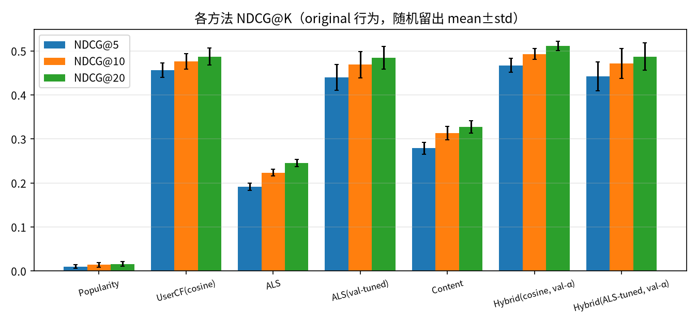
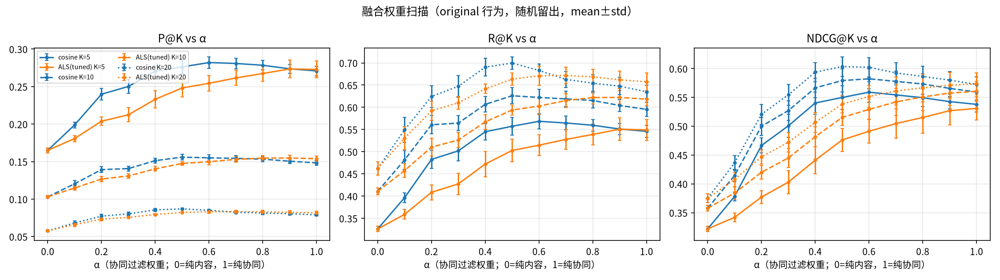
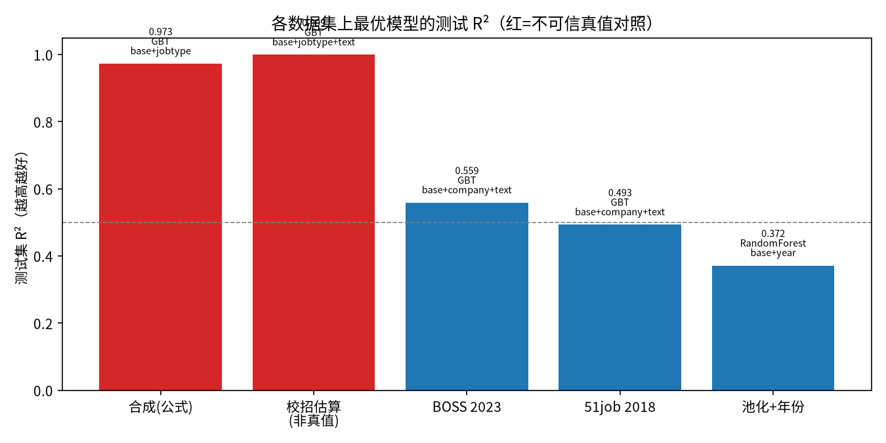
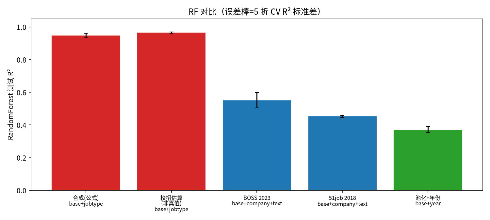
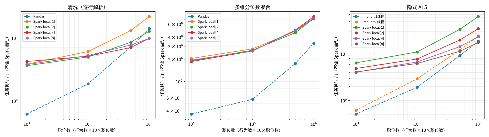
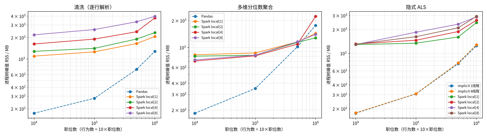
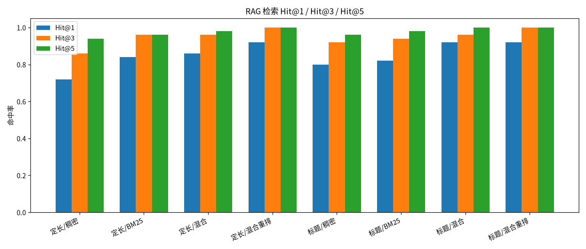
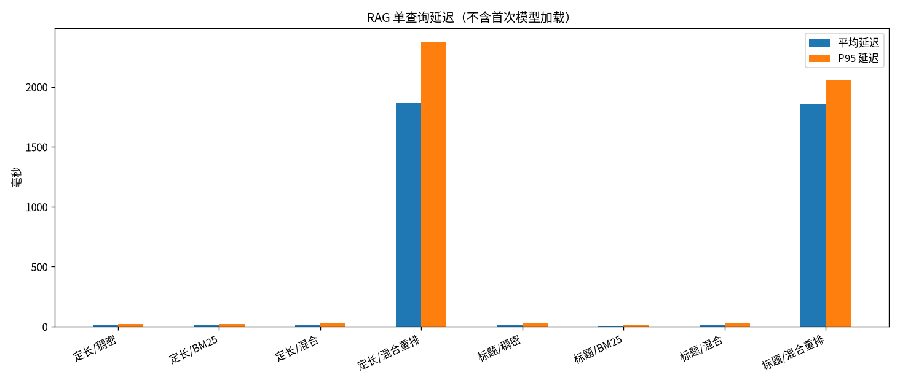

# 实验章节素材（可复现）

所有数字均来自本目录脚本的真实运行，原始输出在 `results/`，图在 `figures/`。
**生产流水线全部使用 PySpark DataFrame**（清洗 / 聚合 / 薪资回归 / 用户余弦协同过滤 / ALS / 推荐离线任务）。本目录的 numpy / Pandas 代码只用于：推荐消融的对照实现（`recommend/numpy_reference.py`，即改造前的 numpy 版本，用来做等价性校验）和扩展性压测。

```bash
export PATH=$HOME/.local/bin:$PATH
# 分项复现（各一条命令）
.venv/bin/python experiments/salary/run_salary_experiment.py --folds 5
.venv/bin/python experiments/recommend/run_recommend_ablation.py --seeds 5
.venv/bin/python experiments/recommend/verify_spark_cf.py   # Spark 协同过滤 vs numpy 参考实现（会真正跑一次推荐任务并写库）
.venv/bin/python experiments/scale/run_scale_bench.py
.venv/bin/python experiments/rag_eval/run_rag_eval.py
bash scripts/start-spark-cluster.sh && .venv/bin/python experiments/spark_cluster/run_cluster_bench.py   # 伪分布式取证（会真正跑生产任务并写库）
```

---

## 2. 推荐算法消融

脚本：`experiments/recommend/run_recommend_ablation.py`  
数据：库内合成行为（`data/generate_demo_data.py`，方向+城市偏好）及对照变体 `pop_noise`（25% 内容偏好 / 50% Zipf 热度 / 25% 均匀）。  
协议：正样本=收藏/投递；每人留出 20%；`random` 重复 5 个种子报 mean±std；`time` 为生产所用的按时间留出（单次）。融合 α 在**训练内验证集**上按 NDCG@10 选择，测试集只报告一次。

### 2.1 主结果（original 行为，random，45 天衰减）

| 方法 | P@10 | R@10 | NDCG@5 | NDCG@10 | NDCG@20 | Cov@10 |
|------|------|------|--------|---------|---------|--------|
| Popularity | 0.0049±0.0008 | 0.0226±0.0057 | 0.0101±0.0040 | 0.0138±0.0048 | 0.0159±0.0050 | 0.004 |
| UserCF(cosine) | 0.1263±0.0047 | 0.5086±0.0204 | 0.4560±0.0164 | 0.4757±0.0176 | 0.4873±0.0189 | 0.171 |
| ALS（生产默认 rank=8） | 0.0717±0.0025 | 0.2951±0.0121 | 0.1914±0.0086 | 0.2233±0.0077 | 0.2454±0.0082 | 0.094 |
| ALS(val-tuned) | 0.1296±0.0065 | 0.5235±0.0303 | 0.4403±0.0292 | 0.4688±0.0298 | 0.4846±0.0261 | 0.238 |
| Content | 0.0916±0.0045 | 0.3673±0.0188 | 0.2790±0.0132 | 0.3131±0.0154 | 0.3274±0.0137 | 0.235 |
| Hybrid(cosine, val-α) | **0.1323±0.0026** | **0.5331±0.0120** | **0.4671±0.0160** | **0.4931±0.0124** | **0.5117±0.0108** | 0.215 |
| Hybrid(ALS-tuned, val-α) | 0.1314±0.0060 | 0.5309±0.0276 | 0.4418±0.0328 | 0.4716±0.0345 | 0.4873±0.0306 | 0.240 |



**CF vs ALS**：用户余弦在演示集上稳定优于默认 ALS；验证集网格（rank∈{8,32,64}×reg∈{0.1,1,10}×alpha∈{5,20,40}）后 ALS 可逼近余弦（NDCG@10 0.469 vs 0.476），仍略低且无因子用户无法在线推断。生产因此用用户余弦做协同过滤，ALS 留在离线任务中作对照（`ai-service/app/spark/recommend.py`）。

### 2.2 α 扫描（测试集敏感性，非选型依据）



余弦融合在 α≈0.4–0.6 达峰；纯内容（α=0）与纯协同（α=1）均低于混合。生产 α 由留出集自动选择（常见 0.4–0.7）。

### 2.3 时间衰减 / 学历惩罚消融

| 设置 | Hybrid(cosine) NDCG@10 (random) | 同方法 (time) |
|------|----------------------------------|---------------|
| 45 天衰减 + 学历×0.35（生产） | 0.4931±0.0124 | **0.3596** |
| 无衰减 + 学历×0.35 | 0.5191±0.0189 | 0.3245 |
| 45 天衰减 + 无学历惩罚 | 0.5165±0.0168 | 0.3730 |

按时间留出时，45 天衰减明显更好（0.360 vs 0.325），与生产协议一致；随机留出下无衰减略高，因合成时间近似均匀。去掉学历惩罚在本合成行为上略升（生成器未把学历不匹配写入负反馈），生产仍保留 0.35 作为业务约束。

### 2.4 冷启动（随机抽 20% 学生）

| 场景 | 最佳方法 | NDCG@10 |
|------|----------|---------|
| full（删光行为） | Content | 0.2714±0.0351 |
| full | Hybrid 兜底 0.75C+0.25P | 0.2391±0.0157 |
| fewshot3（保留 3 条） | Hybrid(α=0.5, adaptive) | **0.3212±0.0209** |

无行为时协同过滤失效，内容匹配是主信号；少量行为后自适应融合超过纯内容。

### 2.5 合成行为偏差（pop_noise 对照）

在弱偏好行为上，**Popularity NDCG@10=0.1763±0.0087 最高**，Content 降至 0.037，Hybrid/UserCF ≈0.17。说明原生成器的「方向+城市」聚集会抬高内容与混合指标；论文需如实写明演示数据偏差，并把 pop_noise 作为压力测试。

原始表：`results/recommend_*_{summary,alpha_sweep,coldstart}.csv`，汇总 JSON：`results/recommend_ablation.json`。

### 2.6 生产实现：Spark 用户余弦与 numpy 参考实现的等价性

生产推荐（`ai-service/app/spark/recommend.py` + `recommend_cf.py`）的衰减评分、用户余弦（按职位自连接，点积与共同交互数一次聚合，收缩 `co/(co+15)`）、Top-40 邻居（Window + row_number）、预测、min-max、40 组融合网格、Top-K 与指标聚合全部是 Spark DataFrame 运算。消融脚本仍调用 `recommend/numpy_reference.py`（改造前的 numpy 实现），所以 2.1–2.5 的数字不受影响。`recommend/verify_spark_cf.py` 在同一份数据上同时跑两种实现并对比（`results/recommend_spark_equivalence.json`，2026-11-02，309 名学生 / 4984 职位 / 10516 个非零评分 / 留出 232 人）：

| 检查项 | 结果 |
|---|---|
| 邻居对（Spark 表 vs numpy） | 8548 vs 8548，Jaccard 0.999766；不一致的 2 对均为第 40 名并列边界（`mismatched_pairs_all_rank40_ties=true`） |
| 共同邻居相似度最大绝对差 | 3.3e-16 |
| CF / 内容 / 融合 Top-10、Top-20 重合率 | 均为 1.0（309 名学生顺序完全一致，匹配分差 0） |
| NDCG@10（numpy = Spark） | 余弦 0.3231、融合 0.3572、内容 0.2544、热门 0.0125；选中参数均为 linear / α=0.55 / 非自适应 |
| 耗时 | numpy 参考 3.4 s（含读库）；Spark 135.1 s（加载 1.6 / 余弦 17.9 / ALS 12.8 / 融合网格评估 87.8 / 生产打分 12.2 / 写库 1.9），8 vCPU `local[*]` |

单机小数据上 Spark 的调度、shuffle 固定开销远大于计算本身，这与第 3 节扩展性结论一致；Spark 版本的意义在于 Driver 不再持有 用户×职位 稠密矩阵，可在 Standalone 集群上横向扩展。

---

## 1. 薪资预测严谨性

脚本：`experiments/salary/{prepare_real_salary,export_platform_jobs,run_salary_experiment}.py`  
数据说明：`data/REAL_DATA.md`（公开 MIT 数据集）与 `data/real_salary/`。

**核心结论**：演示/校招库里的月薪是按方向×城市公式**估算**的，不是官网真值。在估算标签上模型可做到 R²≈0.97–0.999，属于记忆生成公式，**不能**作为论文主结果。公开真实月薪上，最优测试 R² 约 **0.49–0.56**。

### 1.1 协议

- 80/20 holdout（seed=42）+ 训练集 5 折 CV；Ridge/Lasso 的 λ∈{0.01,…,1000} 按 CV 平均 R² 选取。
- 模型：LinearRegression、Ridge、Lasso、RandomForest（100 树）、GBT（80 轮）；另报 MeanBaseline。
- 特征：城市/方向 one-hot、city_tier、edu_years、exp_years；合成/校招另加 job_type；真实数据另加公司规模；可选 jieba→CountVectorizer+IDF 文本。

### 1.2 各数据集最优测试结果（完整表见 `results/salary_metrics.csv`）

| 数据集 | 行数 | 最优模型 / 特征 | 测试 R² | RMSE | MAE | CV R² |
|--------|------|-----------------|---------|------|-----|-------|
| synthetic（公式标签） | 3200 | GBT / base+jobtype | 0.973 | 1581 | 724 | 0.980±0.004 |
| campus_estimated（**非真值**） | 1758 | GBT / base+jobtype+text | 0.999 | 86 | 14 | 0.985±0.013 |
| BOSS 2023（MIT） | 9269 | GBT / base+company+text | **0.559** | 5394 | 3619 | 0.205±0.484* |
| 51job 2018（MIT） | 40896 | GBT / base+company+text | **0.493** | 4868 | 3326 | 0.485±0.013 |
| pooled_real + data_year | 50165 | RF / base+year | **0.372** | 5616 | 3923 | 0.354±0.019 |

\*BOSS 上 GBT 的 CV 方差大，同特征 RF 测试 R²=0.551、CV 0.519±0.046 更稳，生产选用 RF。




### 1.3 生产模型

`ai-service/app/spark/salary_model.py` 仍用 **PySpark MLlib RandomForest**，训练改为 `pooled_real`（BOSS+51job），特征含 `data_year`（预测时固定 2023）。网格预测与 `/public/stats/salary/predict` API 不变。指标文件注明 `trainSource=pooled_real` 与「平台职位薪资为估算」。

---

## 3. Spark 扩展性（Pandas 对照，不改生产）

脚本：`experiments/scale/{run_scale_bench,bench_worker}.py`；数据：`data/generate_demo_data.py --scale N` → `experiments/data/scale/`（已 gitignore）。  
**约束**：生产清洗 / 聚合 / 薪资 RF / ALS / 推荐离线任务仍全部走 `ai-service/app/spark/`（PySpark）。本节只对比单机 Pandas 与 `local[1/2/4/8]`，回答「何时 Spark 相对 Pandas 开始划算」，**不**把生产切到 Pandas。

协议：任务计时**不含** SparkSession 启动（另记 startup≈4.5–5.0s）；父进程每 0.1s 采样进程树 RSS（Python+JVM）；规模 1e4/1e5 各 2 次取中位，5e5/1e6 各 1 次；行为行数 = 10×职位数；ALS = 隐式反馈 rank=16、10 iter（Pandas 侧 `implicit`）。环境：8 vCPU / 16GB，PySpark 4.2.1。

### 3.1 关键结论（诚实）

| 任务 | 小规模（≤1e5） | 交叉点 / 1e6 观察 |
|------|----------------|-------------------|
| 清洗（逐行 classify） | Pandas 更快（1e4: 0.62s vs Spark4 4.24s） | **≈5e5–1e6**：Spark `local[4/8]` 反超（1e6: **9.9s** vs Pandas **14.1s**） |
| 多维分位数聚合 | Pandas 全程更快 | 1e6 仍 Pandas 3.3s < Spark8 7.3s；Spark 峰值内存可更低（Spark8 1.4GB vs Pandas 1.8GB） |
| 隐式 ALS | Pandas/`implicit` 更快 | Spark 随核数近线性加速（1e6: local[1] 63.3s → local[8] **17.6s** ≈ Pandas 18.7s） |

单机演示规模下 Pandas 墙钟常占优；**清洗在 ≥100 万职位时 Spark 任务时间更短**，ALS 在多核下追上。生产仍用 Spark，是为统一批处理管线与后续集群扩展，不是因为本机 1e4 演示数据上 Spark 更快。

### 3.2 代表数字（中位任务秒 / 峰值 RSS MB）

| 规模 | 任务 | Pandas | Spark local[4] | Spark local[8] |
|-----:|------|-------:|---------------:|---------------:|
| 1e4 | clean | 0.62 / 173 | 4.24 / 1624 | 3.78 / 2182 |
| 1e5 | clean | 1.87 / 280 | 5.13 / 1902 | 5.28 / 2589 |
| 5e5 | clean | 7.24 / 713 | 7.06 / 2413 | 7.74 / 3331 |
| **1e6** | **clean** | **14.14 / 1278** | **9.90 / 3771** | **9.85 / 3963** |
| 1e6 | aggregate | 3.31 / 1771 | 7.62 / 2229 | 7.29 / 1403 |
| 1e6 | ALS | 18.70 / 1246 | 23.30 / 2884 | **17.57 / 2927** |

原始：`results/scale_bench.json`、`results/scale_bench_summary.csv`。




---

## 4. RAG 混合检索与评测

脚本：`experiments/rag_eval/run_rag_eval.py`；题集 `questions.jsonl`（50+5）；校验 `validate_questions.py`。  
生产：`ai-service/app/rag/lc_retrievers.py`（LangChain 检索组件）+ `{bm25,rerank,store,chunking}.py`，默认 `RAG_RETRIEVAL_MODE=hybrid`（Markdown 标题切分仍为生产入库方式）。

### 4.1 LangChain 组件化（线上与评测同一实现）

| 环节 | 组件 |
|------|------|
| 稠密 | `ChromaDenseRetriever`（BaseRetriever，包 `langchain_chroma.Chroma`，同一持久集合 `job_knowledge`，余弦空间，`hnsw:search_ef=200`） |
| 关键词 | `JiebaBM25Retriever`（继承 `langchain_community` 的 `BM25Retriever`，jieba 分词，附带原始 BM25 分与命中词数） |
| 融合 | `HybridRRFRetriever`（自定义 BaseRetriever：RRF k=60 + 生产阈值 `keep_candidate`；未用 `EnsembleRetriever`，因为它拿不到逐条余弦/BM25 显著性，无法实现拒答阈值） |
| 重排（可选，默认关） | `ContextualCompressionRetriever` + `CrossEncoderCompressor`（bge-reranker-base），`RAG_RETRIEVAL_MODE=hybrid_rerank` 时启用 |
| 生成 | LCEL：`RunnableParallel(system, prompt) | ChatPromptTemplate | ChatOpenAI | StrOutputParser`，`.astream` 推 SSE |
| 路由 / Agent | `RunnableBranch`：规则路由永远先跑（越权拒答确定性），允许工具调用时由 `create_agent` 建的角色 Agent（`StructuredTool` + 角色白名单）选工具，失败退回规则 |
| 记忆 | `SessionHistory(BaseChatMessageHistory)`，读 `ai_message`（按会话 + 用户） |

评测改为在内存 Chroma（`chromadb.EphemeralClient`）上直接调用上述检索器（之前是脚本自带的 numpy 精确余弦 + 自写 BM25）。改造前后同一命令、同一题集、`--job-limit 1000`：

- 第一次改造后运行时，Chroma 默认 `ef_search=100` 的 HNSW 近似检索漏掉了个别真实 Top-10（q41、q45），定长/hybrid Hit@1 0.86→0.84、标题/dense 0.80→0.78。对同一语料实测 HNSW 与精确余弦的 Top-10 召回：默认参数均值 0.992（最低 0.6），`ef_search=200` 为 1.0。生产集合与评测集合因此都设 `hnsw:search_ef=200`（已有集合启动时 `modify` 调整，不重建）。
- 调整后 8 个配置的 Hit@1/3/5、MRR@10、无关拒答率与改造前**完全一致**，50 题逐题命中名次 0 处差异（对比记录见运行日志）。

| 切分 | 检索 | Hit@1 | Hit@3 | Hit@5 | MRR@10 | 平均 ms | P95 ms | 无关拒答 | 改造前平均 ms |
|------|------|------:|------:|------:|-------:|--------:|-------:|---------:|------:|
| 定长 | dense | 0.72 | 0.86 | 0.94 | 0.804 | 5.2 | 4.4 | 1.0 | 11.2 |
| 定长 | bm25 | 0.84 | 0.96 | 0.96 | 0.899 | 7.8 | 9.6 | 1.0 | 7.7 |
| 定长 | hybrid | 0.86 | 0.96 | 0.98 | 0.913 | 6.6 | 9.4 | 1.0 | 17.1 |
| 定长 | hybrid+rerank | 0.92 | 1.00 | 1.00 | 0.960 | 841.9 | 950.1 | 1.0 | 1862.9 |
| 标题 | dense | 0.80 | 0.92 | 0.96 | 0.870 | 4.4 | 4.4 | 1.0 | 13.8 |
| 标题 | bm25 | 0.82 | 0.94 | 0.98 | 0.886 | 5.8 | 8.8 | 1.0 | 4.9 |
| 标题 | hybrid | 0.92 | 0.96 | 1.00 | 0.947 | 6.5 | 9.7 | 1.0 | 14.9 |
| 标题 | hybrid+rerank | 0.92 | 1.00 | 1.00 | 0.957 | 968.6 | 1099.1 | 1.0 | 1861.5 |

延迟两次运行没有在受控的相同负载下对照，只作量级参考，不据此宣称改造带来加速（rerank 两次分别约 1.86 s 与 0.84–0.97 s）。默认仍选标题切分 + hybrid：Hit@1 与 rerank 相同，延迟低两个数量级。`tests/api/06-rag.sh` PASS=92。




---

## 5. 部署架构 / 伪分布式（Spark Standalone）

脚本：`scripts/start-spark-cluster.sh`、`scripts/stop-spark-cluster.sh`（或 `start-all.sh --spark-cluster` / `stop-all.sh --with-spark`）；取证：`experiments/spark_cluster/run_cluster_bench.py` → `results/spark_cluster.json`。

```
            ┌──────────── 本机 8 vCPU / 16 GB ─────────────┐
 ai-service │ Driver(client 模式, 2g)  ──►  Master 127.0.0.1:7077 (UI 8081)
 或 CLI     │        │                         │
            │        ├──► Worker 1 (2 核/1536m, UI 8082) ─ Executor 2 核/1g
            │        └──► Worker 2 (2 核/1536m, UI 8083) ─ Executor 2 核/1g
            │ MySQL(JDBC 读写)  本地文件系统(parquet/模型, 各进程共享)
            └──────────────────────────────────────────────┘
```

- `SPARK_MASTER` 默认 `local[*]`；设为 `spark://127.0.0.1:7077` 即提交到集群，作业代码不变。集群模式下 ai-service 开动态分配（shuffle tracking），空闲 60–120 s 归还 Executor（实测一次批次结束约 2 分钟后 Master 上该应用 cores 从 4 降为 0）。
- 每个任务在 `spark_task_log.params_json` 记录 `sparkMaster` / `sparkAppId`。

### 5.1 同一数据、两种 master（生产 CLI `app.spark.run_all`，依次各跑一次）

| 任务 | Standalone 集群（4 核） | local[*]（8 线程） | 产出一致 |
|------|------:|------:|:---:|
| clean | 16.24 s | 8.92 s | 是（有效 4096） |
| aggregate | 2.60 s | 1.09 s | 是（983 行） |
| salary_regression | 17.60 s | 15.64 s | 是（R2 0.3605） |
| 三项合计墙钟 | 38.45 s | 27.16 s | |
| recommend | 148.39 s | 127.80 s | 是（19500 行，融合 NDCG@10 0.3602） |

平台接口触发（管理端 `POST /api/admin/spark/run`、`/api/admin/recommend/run`，ai-service 以集群模式运行，应用 `app-20261102194918-0003`）：clean 14.30 s、aggregate 2.10 s、salary_regression 16.83 s、recommend 131.75 s，全部成功。Master `/json` 记录的应用 ID、核数、每 Executor 内存、时长见 `results/spark_cluster.json` 的 `masterApps`。

注意：取证脚本每次提交前等待 Master `coresused=0`。在加这一步之前的一次运行中，ai-service 常驻会话尚未归还 Executor，命令行提交的 clean 排队，耗时 72.9 s，这一次不作为结果。

### 5.2 1e6 行扩展性（`experiments/scale/bench_worker.py --master`，4 核，各 1 次）

| 任务 | 集群 cores.max=4 | local[4] |
|------|------:|------:|
| clean（100 万行 → 有效 808362） | 10.98 s | 11.16 s |
| aggregate | 9.18 s | 7.72 s |
| ALS（619 万对） | 27.43 s | 33.87 s |

每项只跑一次，且 local[4] 的 ALS 这次启动用了 12.3 s（第 3 节 local[4] ALS 为 23.30 s），说明机器负载有波动，**不据此认为集群更快**。clean 的有效行一致，面议 / 异常各差 1 行（96722/64311 对 96721/64312），推测是 `dropDuplicates` 在重复键里保留哪一行取决于分区顺序（未逐行核实）。local[4] clean 首次因子进程缺 `PYTHONPATH` 失败，修复后单独重跑。

结论：伪分布式在单机上不带来加速（4 核对 8 线程、多了序列化），价值在于验证生产作业不改代码即可跑在 Standalone 集群，以及 Master/Worker/Executor 的部署形态；真正的横向扩展需要多台机器与共享存储（HDFS/对象存储），超出本机演示范围。

---

## 附录：接口测试质量

见 [`test_quality_table.md`](test_quality_table.md)（由 `tests/run-all.sh` 真实汇总生成）。

---

## 批任务与在线问答的 CPU 争用

见 [`stability/README.md`](stability/README.md)：Spark 推荐批次运行期间，问答从 6 问 1 次超时（最长 181.59 s）改善为 24/24 完成（最长 18.69 s）；Ollama 解码从 0.4–3 tok/s 恢复到 16.4–18.6 tok/s。
