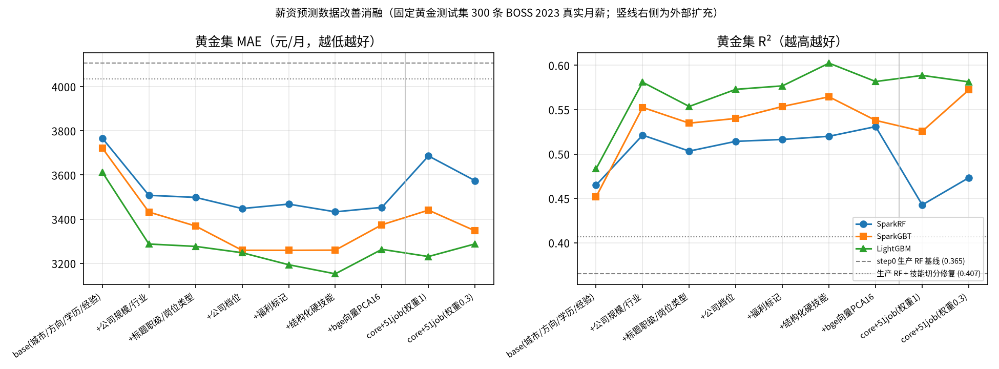

# 薪资预测数据改善与消融报告

所有数字由本目录脚本在 box（8 vCPU / 16 GB，PySpark 4.2.1，LightGBM）上实际跑出。原始结果在 `results/`，图在 `figures/data_improve_ablation.png`。

```bash
.venv/bin/python experiments/data_improve/make_golden.py          # 只需一次；结果确定（md5 不变）
.venv/bin/python experiments/data_improve/run_ablation.py --step step0
.venv/bin/python experiments/data_improve/run_ablation.py --step step1
.venv/bin/python experiments/data_improve/run_ablation.py --step step2
.venv/bin/python experiments/data_improve/make_chart.py
```

## 0. 先说清楚的一点：黄金集为什么不来自平台自爬的 1758 条

平台自爬的 1758 条校招职位来自 16 家大厂。官网接口**不返回薪资，也没有 JD 正文**（只有标题、城市、链接，见 `data/REAL_DATA.md`）。库里的 `salary_min/max` 是按「方向×城市」公式**估算**出来的。拿它当测试集，只能测出模型有没有记住这个公式（以前测过，R²≈0.999），没有意义。

所以黄金测试集改从 **BOSS 直聘 2023**（MIT 公开数据，带真实月薪、职位名、公司名、技能、福利）里抽。这份数据也是生产薪资模型的核心训练源，下文称为 **core**。

## 1. 固定黄金测试集（step0）

- **筛选条件**：
  - 方向不是「其他」；
  - 技能 ≥2 个；
  - 有公司名和福利；
  - 薪资区间上下限比 ≤2；
  - 月薪在 3000–60000 之间。
- **抽样**：按方向分层，每家公司最多 2 条，seed=20261111，共 300 条，覆盖 18 个城市、298 家公司。id 保存在 `golden_test_ids.csv`。
- **防泄漏**：
  - 黄金集不参与任何训练、编码器/词表/PCA 拟合、插补或外部混入。
  - 和黄金行「同公司 + 同标题」的另外 62 条近重复行也从训练里排除。
  - 两类合计 362 个 id，写在 `train_exclude_ids.csv`，生产 `ai-service/app/spark/salary_model.py` 训练时同样排除。
- **指标**：在黄金集上报告 MAE、RMSE、R²，并附 1000 次 bootstrap 的 95% 置信区间。300 条样本下，R² 的置信区间宽约 ±0.1，**差距小于 0.03 的结论不可靠**。

## 2. 结果（黄金集，月薪单位：元）

| 阶段 | 训练数据 / 特征 | 模型 | n_train | MAE | RMSE | R² (95% CI) |
|---|---|---|---:|---:|---:|---|
| step0 | 均值基线 | Mean | 8907 | 5726 | 7852 | -0.001 |
| step0 | **现生产**：pooled_real（BOSS+51job），城市/方向/学历/经验/年份/技能 | Spark RF | 49803 | 4106 | 6255 | **0.365** [0.276, 0.457] |
| step0 | core，base | Spark RF | 8907 | 3745 | 5736 | 0.466 |
| step0 | core，base+公司+标题技能 TF-IDF（旧实验最优） | Spark GBT | 8907 | 3385 | 4860 | 0.617 [0.518, 0.701] |
| step1 | 生产管线 + 技能切分修复（已上线） | Spark RF | 49803 | 4034 | 6046 | **0.407** [0.327, 0.486] |
| step1 | core F0 base | LightGBM | 8907 | 3613 | 5642 | 0.483 |
| step1 | core F1 +公司规模/行业 | LightGBM | 8907 | 3288 | 5081 | 0.581 |
| step1 | core F2 +标题职级/岗位类型 | LightGBM | 8907 | 3277 | 5245 | 0.554 |
| step1 | core F3 +公司档位 | LightGBM | 8907 | 3248 | 5130 | 0.573 |
| step1 | core F4 +福利标记 | LightGBM | 8907 | 3194 | 5106 | 0.577 |
| step1 | core F5 +结构化硬技能 | LightGBM | 8907 | **3153** | 4950 | 0.602 [0.499, 0.702] |
| step1 | core F6 +bge 向量 PCA16（**训练集 5 折 CV 选定**） | LightGBM | 8907 | 3264 | 5076 | 0.582 |
| step1 | F6，目标 = log(月薪) | LightGBM | 8907 | 3184 | 5027 | 0.590 |
| step1 | F6，目标 = 上下限分别预测再取中位 | LightGBM | 8907 | 3204 | 5007 | 0.593 |
| step2 | core only（F6+year） | LightGBM | 8907 | 3264 | 5076 | 0.582 |
| step2 | core + 51job 2018（权重 1） | LightGBM | 49803 | 3231 | 5035 | 0.589 |
| step2 | core + 51job 2018（权重 0.3） | LightGBM | 49803 | 3288 | 5079 | 0.581 |
| step2 | core + 51job（权重 1） | Spark RF | 49803 | 3686 | 5860 | 0.443 |
| step2 | core + 51job（权重 0.3） | Spark GBT | 49803 | 3347 | 5133 | 0.572 |

Spark RF、Spark GBT、LightGBM 三个模型的逐行结果见 `results/summary.csv`。



### 怎么读这些结果（诚实版）

1. **最大的一步是「只用 core 训练」加上「公司规模/行业」。** 生产 RF 用 pooled 数据（BOSS 2023 + 51job 2018）只有 0.365。在同口径的 BOSS 黄金集上，单用 core 的 base 特征就有 0.47，再加公司特征到 0.52–0.58。51job 是 2018 年的数据，缺技能和公司名，混进来会稀释 2023 年的分布。
2. **特征工程能稳定降低 MAE：**
   - LightGBM 的 MAE 从 3613 降到 3153（F5，降 12.7%）；
   - Spark GBT 从 3722 降到 3260；
   - Spark RF 从 3767 降到 3433。
   - R² 的提升都落在置信区间内。F5 的 0.602 与旧实验中 TF-IDF + GBT 的 0.617 基本持平，但 MAE 更低（3153 vs 3385）。
3. **职级/岗位类型规则在 R² 上略有回落**（0.581→0.554）。原因是黄金集里带「高级/专家」字样的行很少，规则作用的面窄，噪声更大。训练集 CV 上它仍然是正贡献（0.526→0.547）。公司档位、福利、结构化技能在训练集 CV 和黄金集上都是正向的。
4. **bge 向量 PCA 在训练集 CV 上和 F5 打平**（0.6067 vs 0.6050），所以按规则选了 F6。但它在黄金集上略差。这里没有回头按黄金集改选型，以免测试集泄漏。
5. **把目标换成 log 月薪，或分别预测上下限，**对 LightGBM 略有帮助，对 Spark RF/GBT 有好有坏。
6. **外部扩充（51job）基本没有帮助：** LightGBM 持平，Spark GBT 降权后持平，Spark RF 明显变差。飞书 ATS 职位**不带薪资**（1757 条里只有 1 条在 JD 正文里写了「2500 月薪制」的实习），所以扩充对薪资模型**新增的训练样本是 0**。它的价值在平台职位库，不在薪资回归。
7. **生产路径保持 Spark RF 不变**，只修了一个 bug：BOSS 的技能以空格分隔，旧代码按 `、;/|` 切分，整串技能被当成一个词，进不了 minDF=5 的词表。修复后黄金集 R² 从 0.365 升到 0.407，生产随机留出 R² 为 0.358（训练 40080 / 测试 9723）。新特征需要 API 提供公司名、福利等输入，暂时没有接进生产预测接口。

## 3. 特征说明（`features.py`、`extract.py`、`company_tier.csv`）

- **(a) 结构化抽取**：职位文本被抽成 JSON，字段为 `hard_skills / min_education / experience / category`。
  - 两种后端：
    - `rule`：技能词典约 60 个规范名加别名正则，确定性，默认使用；
    - `llm`：任意 OpenAI 兼容接口，环境变量为 `EXTRACT_LLM_BASE_URL / EXTRACT_LLM_MODEL`，未设置时沿用 `LLM_*`。
  - LLM 结果按 sha1 键缓存在 `cache/extract_llm.jsonl`，重跑不花钱。
  - box 上用 qwen2.5:3b（CPU，约 3.1 s/条）抽样 100 条：类别与规则一致率 0.86，技能 Jaccard 0.80，0 条失败。
  - 全量 9269 条在 CPU 上约 8 小时，所以表中结果都是 **rule 后端**。本地有显卡时可以跑全量（见文末）。
  - **限制**：BOSS 和 51job 都没有 JD 正文，输入只有「职位名 + 技能标签 + 福利」。飞书扩充职位带完整 JD，可以用来演示 LLM 从 JD 抽取。
- **(b) 公司档位**：7 档——头部大厂、外企、国企/央企/金融科技子公司、上市/大型民企、中型、小型/创业、外包/人力服务。
  - 依据是人工列举的关键词表 `company_tier.csv`（每行注明依据）。外包优先匹配，例如华为驻场按外包计。
  - 列表没命中时，按 51job 的公司性质和公司规模兜底：≥5000 人为大型，500–9999 人为中型，≤499 人为小型。
  - 训练集各档平均月薪：小型 11884、外包 12967、国企系 15480、中型 15856、外企 17197、大型民企 17383、头部大厂 26354。
- **(c) 职级/岗位类型**：从标题按规则抽取，分 7 级（实习 / 校招 / 初级 / 中级·未注明 / 高级 / 专家·经理 / 总监），另有外包、实习、校招、管理、兼职标记。训练集里各级月薪单调上升（高级 19478、专家 28094）。
- **福利标记**：股票期权、年终奖、13 薪以上、包吃住、班车、弹性、补充医疗、加班费，外加福利条数。「·13薪」出现在薪资字段里，属于标签的一部分，所以**没有**作为特征使用。
- **(d) 文本向量**：用 bge-small-zh-v1.5（与 RAG 同一模型）编码「职位名 + 技能」，再 PCA 降到 16 维，PCA 只在训练折上拟合。
- **(e) 目标**：中位数、log 中位数、上下限分别预测三种。
- **没有做的**：没用 SMOTE（这是回归任务）；没有对 Offershow/KNN 做薪资插补，训练集和测试集都没有插补过的标签。

## 4. 外部扩充职位库（step2）

### 飞书招聘（`*.jobs.feishu.cn`）

- **抓取方式**（`data/crawl_feishu_ats.py`）：
  - 只用门户页面本身的公开流程：先取门户 CSRF token，再分页调职位检索；
  - 不登录，不处理签名或加密；
  - 每次请求间隔 1.2 s，每家公司最多 300 条；
  - 该域名 robots.txt 返回 404，即没有限制。
- **抓取结果**：12 家公司共 1757 条。**没有一条带薪资字段。**
- **导入**（`data/import_ats_jobs.py`）：只保留职位名能归入平台 12 个 IT 方向、且不是销售/制造/职能类的岗位，共 **600 条**：

| 公司 | 门户 | 列出 / 抓取 | 入库（IT 岗） |
|---|---|---:|---:|
| 中科创达 | thundersoft | 137 / 137 | 109 |
| 商汤科技 | sensetime | 142 / 142 | 97 |
| MiniMax | vrfi1sk8a0 | 109 / 109 | 76 |
| 德赛西威 | yesv-desaysv | 116 / 116 | 67 |
| 懂车帝 | dcar | 655 / 300 | 63 |
| 小鹏集团 | xiaopeng | 611 / 300 | 52 |
| 禾赛科技 | kwh0jtf778 | 153 / 153 | 47 |
| 影石创新 | arashivision | 140 / 140 | 35 |
| 蔚来 | nio | 1117 / 300 | 21（多为销售顾问 / 制造岗，被过滤） |
| 卡尔动力 | kargobot | 30 / 30 | 16 |
| 灵御智能 | dexteleop | 24 / 24 | 12 |
| 芯动科技 | intchains | 6 / 6 | 5 |

- **入库方式**：
  - 职位写入 `job_position.data_source='ext_ats'`，账号为 `ext_<key>`，信用代码前缀 `EXTA`；
  - 自爬的 1758 条标为 `self_crawl`，平台发布的 3202 条为 `platform`；
  - 岗位职责和任职要求保存官网原文；
  - 薪资用与自爬库同一个估算函数生成，详情页显示「估算薪资」，**不参与任何薪资训练或评测**。
- **前台优先展示核心库**：外部职位的 `publish_time` 统一设在库内最早职位之前，`view_count` 为 0。所以默认的「最新」排序下，外部职位排在核心库之后；「热门」排序下，它们排在有浏览量的职位之后。后端代码不需要改动，本地还没执行迁移时检索也不会报错。实测：
  - 最新 50 条里没有外部职位；
  - 关键词「算法」的第一页都是核心库职位；
  - 按薪资排序时不做区分。
- **Moka（app.mokahr.com）放弃**：职位接口返回的 `data` 是 AES 加密字符串，解密等于绕过前端保护，按约定停在这一步。robots.txt 只禁止了两个站点。
- **外部数据集**：MIT 的 51job 2018 IT 子集（40896 条）已按字段对齐，作为薪资扩充样本，结果见第 2 节。

## 5. 数据真实性与限制

| 数据 | 性质 |
|---|---|
| BOSS 2023（core / 黄金集） | 真实月薪，第三方公开数据集（MIT），2023 年抓取；方向以 Java / 后端 / 测试为主 |
| 51job 2018 | 真实月薪，2018 年，没有技能和公司名，水平偏旧 |
| 自爬 1758 条 / 飞书 600 条 | 真实职位，**薪资是估算的**，只用于展示和推荐 |
| 用户行为 | 合成（见 `experiments/README.md` 2.5 节），本报告不涉及 |

- 黄金集只有 300 条，R² 的 95% 置信区间宽约 0.2；结论应主要看 MAE，以及 CV 和黄金集方向是否一致。
- 黄金集和 core 来自同一数据源，**不代表对 2026 年大厂校招薪资的预测能力**，后者没有真实标签可以评测。
- 公司档位表是人工整理的，只覆盖高频公司，长尾公司靠规模兜底。
