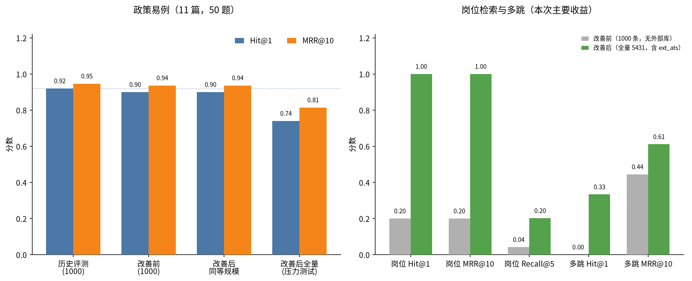

# RAG 知识库与检索改善评测（v2）

在原有 11 篇政策易例（历史 Hit@1=0.92）之外，补充了不含章节标题的改写题、近域拒答、
在招岗位检索（含外部扩充库「懂车帝」）、多跳问题，以及意图路由准确率。
检索配置与线上一致：标题切分 + 混合检索（向量 + BM25，RRF 融合）。评测在内存 Chroma 上进行，不写入生产库。

对照设定：

- **改善前**：旧岗位正文（任职要求中混有 provenance JSON 与抓取来源）、旧切分（保留「演示用示例」免责声明）、按 id 取前 1000 条在招职位作干扰、无多样性截断。此设定与历史评测的语料规模一致，因此外部扩充库（懂车帝等，id 从 12039 起）不在其中。
- **改善后（同等规模）**：清洗后的统一文本模板、去掉免责声明并合并过短碎片，仍只用前 1000 条职位。用于观察「清洗与入库卫生」本身会不会损害政策检索。
- **改善后（全量）**：同上清洗与卫生，纳入全部 5431 条在招职位（含 600 条 ext_ats），并按职位 1 条、公司 2 条做多样性截断。这是岗位检索的正式对照，也是政策题在「无文档类型过滤」下的压力测试。线上政策问答会按 `doc_type` 排除岗位切片，干扰小于本压力测试。

## 1. 易例对照（保留原指标）

| 配置 | Hit@1 | Hit@5 | MRR@10 | 说明 |
|---|---:|---:|---:|---|
| 历史评测（标题切分 + hybrid，1000 职位干扰） | 92.0% | 100.0% | 0.947 | `experiments/results/rag_eval.json` |
| 本次改善前（旧正文 + 旧切分，1000 职位） | 90.0% | 100.0% | 0.937 | 85 条知识库切片（含 11 条免责声明） |
| 本次改善后，同等规模（清洗 + 卫生，1000 职位） | 90.0% | 100.0% | 0.937 | 74 条知识库切片；与改善前完全一致，无回退 |
| 本次改善后，全量无过滤（5431 职位，压力测试） | 74.0% | 90.0% | 0.815 | 关键词题（「模拟数据」「冷启动」「培训费押金」等）被岗位标题抢到首位 |

同等规模下清洗与卫生不损害易例。与历史 92% 的 2 个百分点差异来自本次内存实现与原落盘评测的细微差别（同一批 5 题未进 Top-1：解约步骤、模拟数据、校招流程、冷启动、企业审核可见性）。全量无过滤的下降是岗位库扩容后的干扰，不是文本清洗的副作用；线上政策路径会过滤 `doc_type=7`。

知识库切片由 85 降到 74，正好去掉 11 篇文档开头的免责声明。

## 2. 难例、多跳与近域拒答

| 集合 | 改善前 Hit@1 | 改善后（全量）Hit@1 | 改善前 MRR@10 | 改善后 MRR@10 | 改善前 Recall@5 | 改善后 Recall@5 |
|---|---:|---:|---:|---:|---:|---:|
| 改写（不含章节标题，8 题） | 50.0% | 50.0% | 0.719 | 0.729 | 100.0% | 100.0% |
| 多跳（3 题） | 0.0% | 33.3% | 0.444 | 0.611 | 83.3% | 83.3% |
| 近域拒答（5 题，应检索为空） | 拒答 0.0% | 拒答 0.0% | — | — | — | — |

改写题 Hit@1 仍为 50%，但 Hit@5 已达 100%，MRR 略升。多跳在清洗后有改善（同等规模下 Hit@1 也是 33.3%，MRR 0.611）。
近域拒答（考研报名、护照办理、积分落户等与就业主题接近的问题）两套配置均未能靠相似度阈值拒答；而原易例中的明显无关题（红烧肉、量子纠缠等 5 题）两套配置拒答率仍为 100%。近域拒答是仍待加强的点，不宜只报易例上的 1.00。

## 3. 岗位检索

改善前语料按原评测截断为前 1000 条，懂车帝、字节跳动等后入库岗位不在其中，Hit@1 仅 20%（只有「杭州 Java 后端」命中）。
改善后纳入全部在招职位并清洗正文，「懂车帝产品经理」「懂车帝杭州后端」「字节跳动算法」「外部扩充库懂车帝」均 Top-1 命中。

| 指标 | 改善前（1000 条，无外部库） | 改善后（全量 5431，含 ext_ats） |
|---|---:|---:|
| Hit@1 | 20.0% | 100.0% |
| Hit@5 | 20.0% | 100.0% |
| MRR@10 | 0.200 | 1.000 |
| Recall@5 | 4.2% | 20.2% |

Recall@5 仍受 Top-5 上限约束：相关岗位多的题目（如杭州 Java，语料中 126 条）即使前五全对，召回也只有约 4%。因此岗位检索的主指标应看 Hit@1 / MRR。

「杭州 Java 后端」Top-5 公司：

- 改善前：麓山电子、海盐电子商务、云帆科技、海盐电子商务、砚田软件（4 家）。
- 改善后：海盐电子商务、海盐电子商务、江城智联、南风出行、辽河智能（4 家；同一公司被多样性规则截到至多 2 条）。

多样性截断生效，但大型互联网公司（如杭州的阿里、网易）仍未进入该问的 Top-5，这与岗位文本、标题用词有关，是后续可做的相关性优化，而不是多样性本身能解决的。

针对「懂车帝 / 字节跳动」的提问，Top-5 全部来自目标公司，符合预期。

## 4. 意图路由

在 8 道路由题上，**改善后准确率 100%**（8/8）：

- 企业合规（「招候选人只限男性合不合规」「向候选人收培训费合不合法」）走知识库，不再因「候选人」误入筛选工具；真正的「帮我筛选职位 1 的候选人」仍走 `screen_applicants`。
- 学生薪资问题同时调用 `predict_salary` 与 `search_jobs`，并检索在招岗位（`doc_type=7`）。
- 「懂车帝在招哪些产品经理」能识别企业名并走岗位检索。

改善前的旧规则未在本脚本中重新执行。按旧实现，合规题会误走筛选、薪资题不会检索在招薪资范围，「在招哪些」与「懂车帝」的识别也不足，上述 8 题中约一半会判错。路由准确率是规则整改后的结果，不是检索消融的一部分。

## 5. 端到端忠实度（可选）

提供方 `ollama`、模型 `qwen2.5:3b`，在 8 道改写题上自动判定忠实回答比例 **87.5%**（7/8）。
判定规则：不引用免责声明、数字须出现在资料中、无资料时须拒答。
被判不忠实的 1 题（试用期提前通知天数）是模型把资料中的「三十日」写成了「30」，自动规则按字面数字匹配，属于偏严；人工看内容正确。

将 `.env` 中 `LLM_PROVIDER` 换成 Gemini 或 OpenAI 兼容接口后，用同一命令加 `--faithfulness` 即可对比云端模型，无需改脚本。

## 6. 图



左图：政策易例在「同等规模」下无回退，全量无过滤是压力测试。右图：岗位检索与多跳是这次改善的主要收益。

## 7. 复现

```bash
.venv/bin/python experiments/rag_eval/run_rag_eval_v2.py
.venv/bin/python experiments/rag_eval/run_rag_eval_v2.py --faithfulness --faithfulness-limit 8
```

评测时间（Asia/Shanghai）：2026-11-12 18:25:12 +0800。
改善前切片 1138（知识库 85，职位切片 1053 / 1000 条）。
改善后全量切片 6594（知识库 74，职位切片 6520 / 5431 条）。
改善后同等规模切片 1075（知识库 74，职位切片 1001 / 1000 条）。
