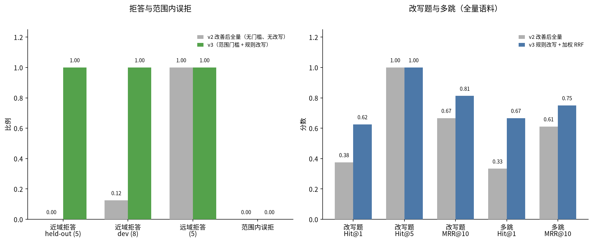

# RAG 范围门槛与查询改写评测（v3）

在 v2「改善后全量」语料上（清洗后的 74 条知识库切片 + 全部 5431 条在招职位，
含 600 条 ext_ats；混合检索，多样性截断），只改变两项线上已默认开启的能力：

1. **近域范围门槛**：领域意图（in / out / unknown）+ 按 dev 集标定的稠密余弦门槛。
   考研报名、护照办理等知识库未覆盖的相近问题应拒答，并提示可问范围；范围内问题不得误拒。
2. **政策问题规则改写**：同义替换（就业意向书→三方协议、考察期→试用期等）与多跳拆分，
   多路结果用加权 RRF 融合（原问权重 2，改写权重 1）。仅检索职位时不改写。
   云端模型可额外做 LLM 改写（`RAG_QUERY_REWRITE_LLM=auto`），本评测关闭 LLM，保证可复现。
   政策交叉编码器重排默认关闭，附录给出打开后的对照。

对照的「改善前」就是 v2 报告里的「改善后全量」设定：同一语料、同一检索，但**没有**范围门槛、也**没有**查询改写。
两组数字都在本次同一索引上重跑，避免实现细节差异。评测在内存 Chroma 上进行，不写入生产库。

## 1. 近域拒答（标定在 dev，报告在 held-out）

门槛在「仅知识库 74 切片」上标定（2026-11-12）：近域 OUT 最高余弦约 0.63（积分落户 vs 户口迁移），
OUT 门槛取 **0.82**；短关键词已归入 in，UNKNOWN 门槛取 **0.62**。本表在全量语料（含 5431 岗位干扰）上报告。

| 集合 | v2 全量拒答 | v3 拒答（有门槛） | 说明 |
|---|---:|---:|---|
| 近域 held-out（r01–r05：考研报名、四级、护照、国考、积分落户） | 0.0% | 100.0% | 与 v2 报告中的 0% 对应；v3 应全部拒答 |
| 近域 dev（rd1–rd8，标定集） | 12.5% | 100.0% | 只用于标定。无门槛时 12.5% 是 rd3 本身已无命中 |
| 远域（红烧肉、量子纠缠等 5 题） | 100.0% | 100.0% | 原先靠相似度阈值已能拒，不能回退 |
| 范围内误拒（易例有金标 + 改写 + 多跳 + 岗位） | 0.0% | 0.0% | 应为 0；已无命中的题目不计为误拒 |

held-out 近域在无门槛时最高余弦仍低于 0.82，靠意图识别为 out 后拒答，而不是把相似度门槛提高到误伤范围内问题的程度。
「因为考公不想去了」这类范围内问句不会被「国考」规则误伤（OUT 模式要求报名/入口等办理用语）。

## 2. 改写题与多跳（全量语料）

与 v2 第 2 节同一批题目，在同一索引上重跑无改写对照。
v2 报告发表的改写题 Hit@1 为 50%、MRR 0.729；本次无改写重跑为 37.5%、MRR 0.667。
差异集中在 h08：金标切片余弦仍是 0.723（与 v2 相同），但「测试实习生」等岗位标题靠 BM25 排到了前两名。
规则改写把「考察期」换成「试用期」后，该金标回到第 1（余弦 0.806）。对照以本次同一索引为准。

| 集合 | 指标 | 本次无改写（同一索引） | v3（规则改写 + 加权 RRF） |
|---|---|---:|---:|
| 改写（8 题，不含章节标题） | Hit@1 | 37.5% | 62.5% |
|  | Hit@5 | 100.0% | 100.0% |
|  | MRR@10 | 0.667 | 0.812 |
| 多跳（3 题） | Hit@1 | 33.3% | 66.7% |
|  | Hit@5 | 100.0% | 100.0% |
|  | MRR@10 | 0.611 | 0.750 |
| 政策易例（全量无过滤，压力测试） | Hit@1 | 74.0% | 76.0% |
|  | MRR@10 | 0.822 | 0.836 |
| 岗位检索（5 题） | Hit@1 | 100.0% | 100.0% |
|  | MRR@10 | 1.000 | 1.000 |

岗位检索默认不改写，Hit@1 保持 100%。政策易例是全量无 `doc_type` 过滤的压力测试，线上政策路径会排除岗位切片，干扰小于本表。
改写题上，h03（考察期→试用期）从第 2 升到第 1，h08 从第 3 回到第 1；h04、h05、h07 仍在第 2。
多跳上，m01 从第 2 升到第 1，m03 保持第 1，m02 从第 3 降到第 4（加权 RRF 把同文档的其他节提前了），净 Hit@1 仍从 33.3% 升到 66.7%。

### 改写题逐题排名

| 题号 | 问题（节选） | 本次无改写 | v3 改写后 |
|---|---|---:|---:|
| h01 | 学校、用人单位和我本人签的那份就业意向书，和入职后要签的劳动合约 | 1 | 1 |
| h02 | 已经在网上点了接受，后来因为考公不想去了，一般要先走什么手续、钱 | 1 | 1 |
| h03 | 还在考察期内自己不想干了，需要提前多久告诉公司？过了考察期呢？ | 2 | 1 |
| h04 | 入职之后最晚什么时候要把正式劳动合约签下来？只签了就业意向算不算 | 2 | 2 |
| h05 | 写招聘启事的时候能不能限定只要男生，或者让入职的人交培训费、必须 | 2 | 2 |
| h06 | 毕业还没找到单位，档案和户口能不能先转回老家的人才中心，以后签约 | 1 | 1 |
| h07 | 单位口头说能解决户口但协议里没有写指标，这能当作已经承诺了吗？ | 2 | 2 |
| h08 | 不同期限的合同，前面那段考察时间最长分别能约定多久？考察期工资能 | 3 | 1 |

### 多跳逐题排名

| 题号 | 问题（节选） | 本次无改写 | v3 改写后 |
|---|---|---:|---:|
| m01 | 已经签了就业协议后又反悔，和已经入职在考察期内自己离职，两边提前 | 2 | 1 |
| m02 | 三方协议里的违约条款，和正式劳动合约里因为专项培训约定的服务期， | 3 | 4 |
| m03 | 企业发布职位时怎样避免写出违规条件，学生如果遇到只要男生或要交培 | 1 | 1 |

## 3. 时延

规则改写会多检索 1–3 路，时延应仍可接受。政策重排（交叉编码器）默认关闭。

| 配置 | 查询次数 | 平均 | P50 | P95 |
|---|---:|---:|---:|---:|
| v2 全量（单路） | 84 | 34 ms | 28 ms | 62 ms |
| v3 规则改写 | 84 | 49 ms | 33 ms | 145 ms |
| v3 + 政策重排（附录，默认关闭） | 84 | 1078 ms | 1158 ms | 1892 ms |

## 4. 附录：政策重排

`RAG_POLICY_RERANK=true` 时，仅对非职位查询在融合后再做交叉编码器重排。默认关闭。

| 集合 | 指标 | v3（无重排） | v3 + 重排 |
|---|---|---:|---:|
| 改写 | Hit@1 | 62.5% | 75.0% |
| 改写 | MRR@10 | 0.812 | 0.838 |
| 多跳 | Hit@1 | 66.7% | 66.7% |
| 多跳 | MRR@10 | 0.750 | 0.833 |

重排把改写题 Hit@1 再抬到 75%，多跳 MRR 从 0.750 升到 0.833，但平均时延约 1.1 秒（P95 约 1.9 秒），
且 h03 从第 1 掉到第 5、m03 从第 1 掉到第 2。线上默认关闭，需要时再开 `RAG_POLICY_RERANK=true`。

## 5. 图



左图：近域拒答是本轮主要收益，范围内误拒应保持为 0。右图：改写题与多跳在全量语料上的对照。

## 6. 复现

```bash
.venv/bin/python experiments/rag_eval/run_rag_eval_v3.py
.venv/bin/python experiments/rag_eval/run_rag_eval_v3.py --rerank
```

评测时间（Asia/Shanghai）：2026-11-12 22:54:58 +0800。
语料切片 6594（知识库 74，职位切片 6520 / 5431 条）。
与 v2 改善后全量相同。嵌入按语料哈希缓存于 `experiments/results/.embed_cache/`（不入库）。
