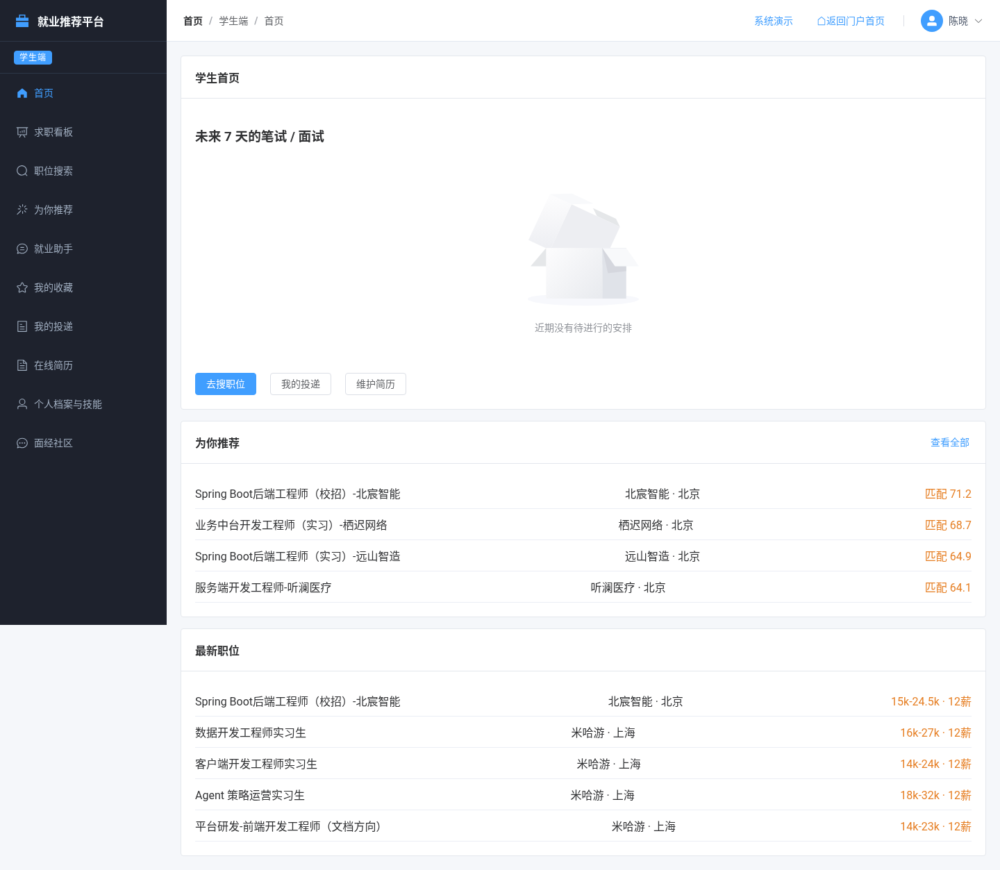
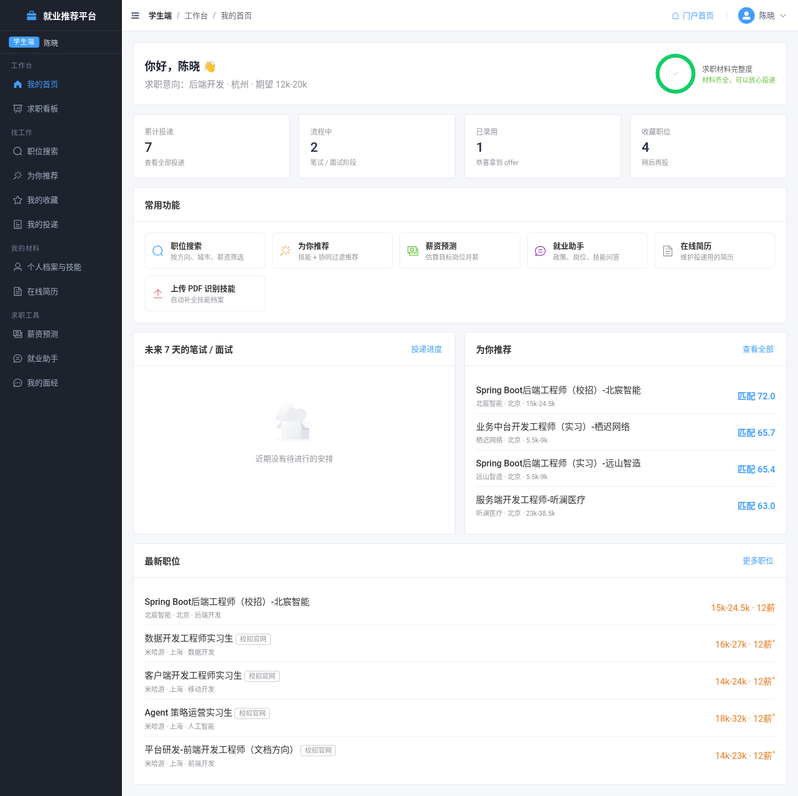
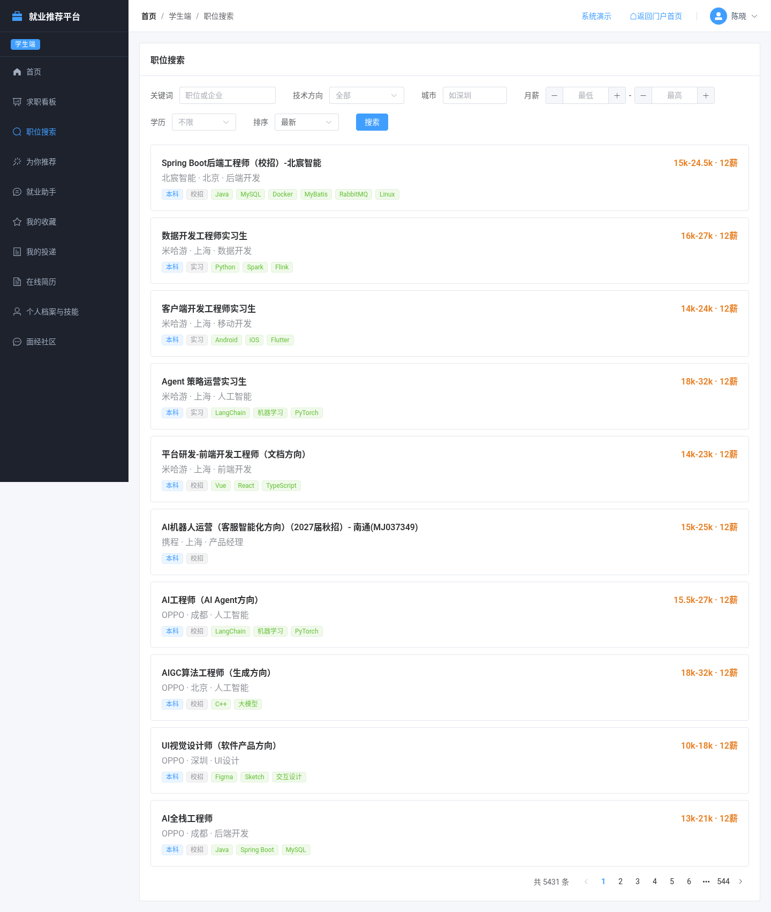
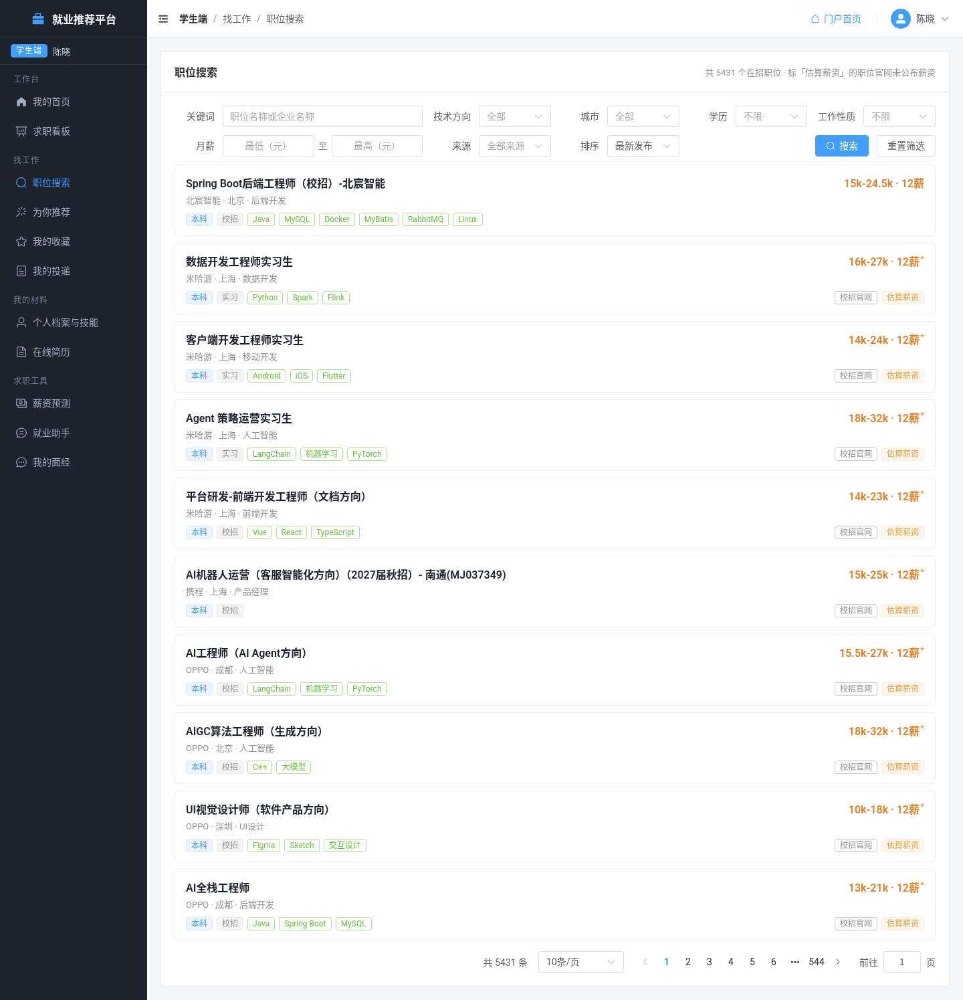
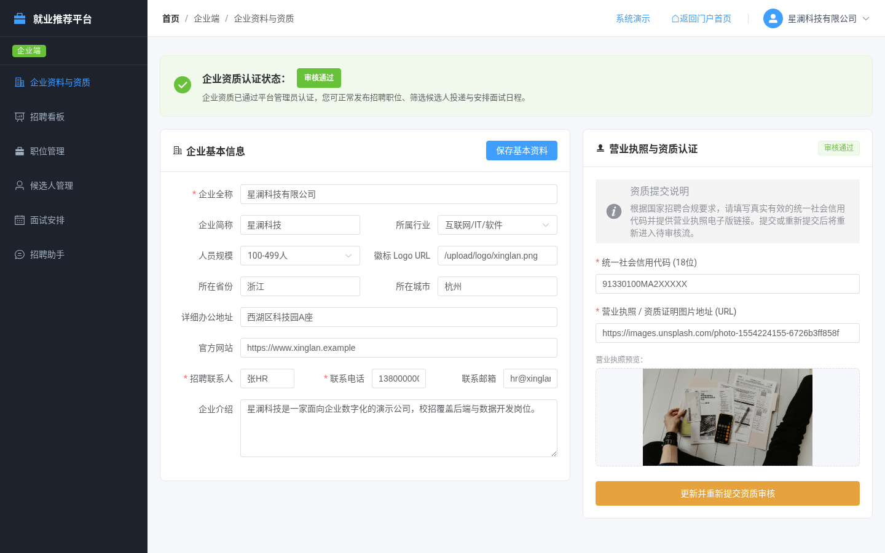
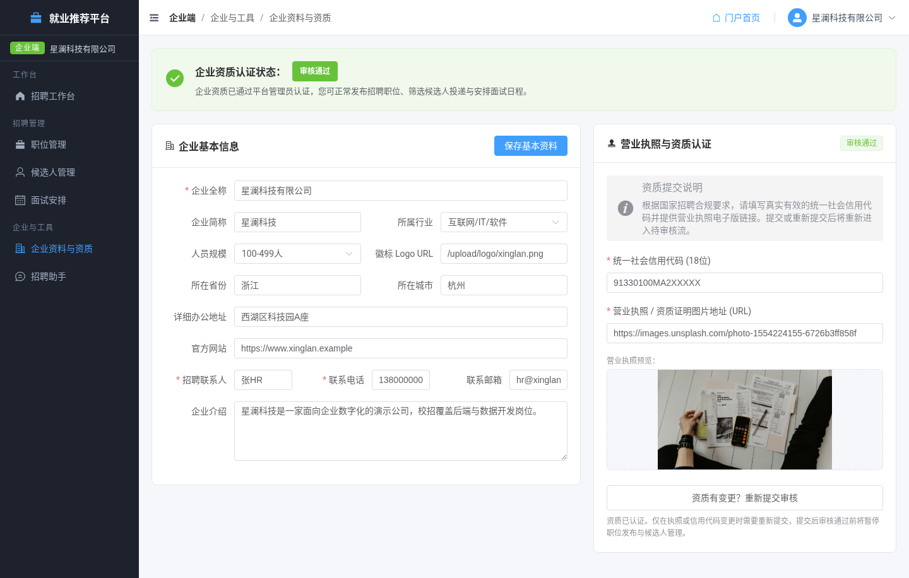
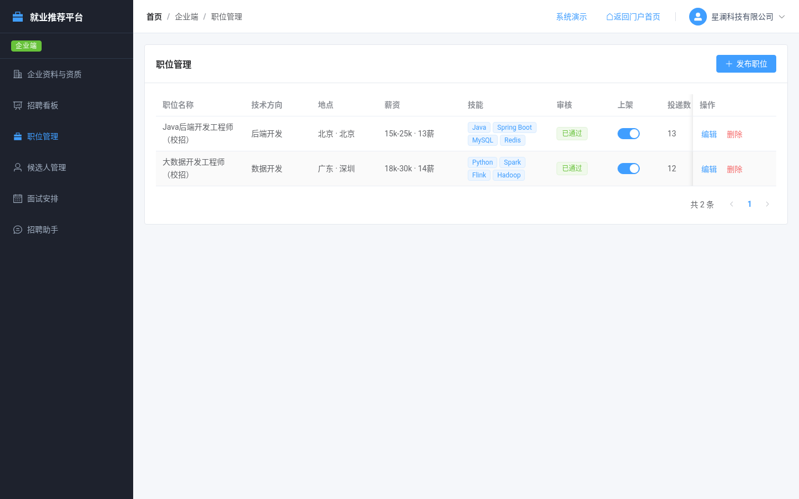
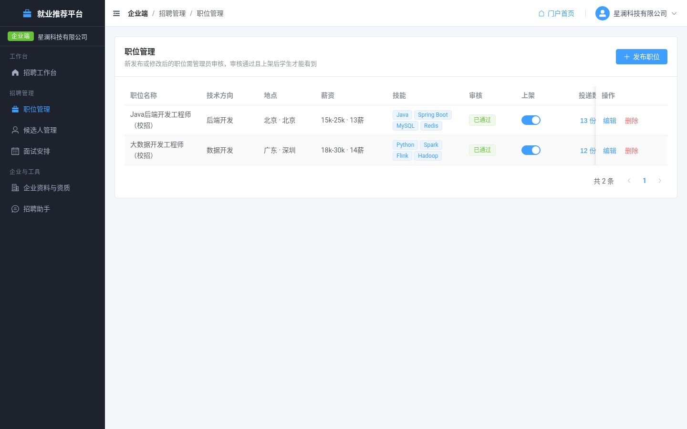
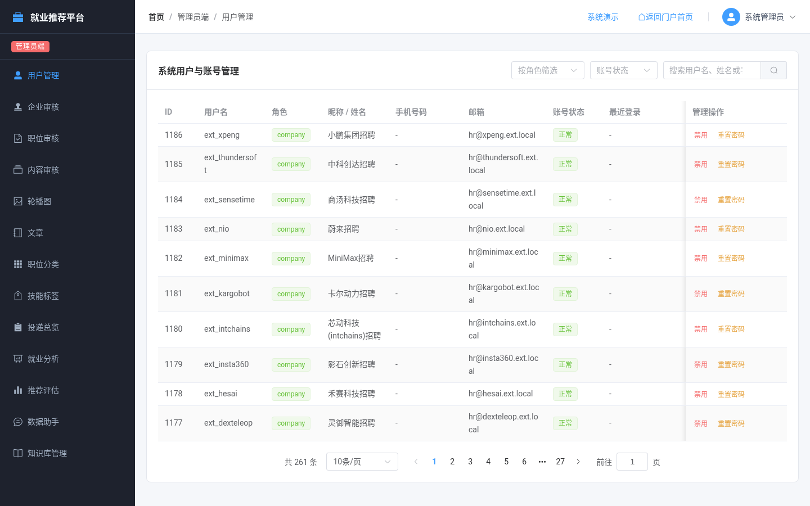
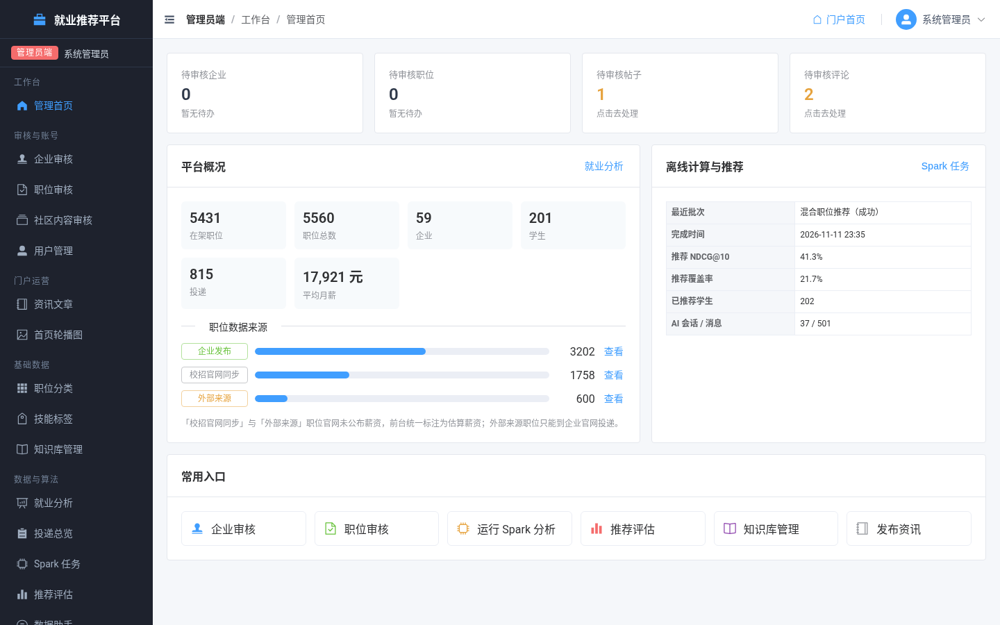

# 全系统 UX 整改记录（2026-11-11）

> 目标：让学生 / 企业 / 管理员三端“真正能用”——导航清楚、每个角色有工作台首页、空态与报错有引导、外部来源职位不误导。
> 环境：Vue 3 + Element Plus（5173）、Spring Boot（8080）、FastAPI + Spark（8000）、MySQL 8.4。
> 验证：`bash tests/run-all.sh` 全部通过（16 个脚本 845 PASS / 0 FAIL）；`pnpm build` 通过；三端 44 个页面自动截图巡检，没有控制台错误，也没有接口报错。

## 1. 整改前发现的问题

自动巡检脚本（playwright，逐角色登录后访问全部菜单页，记录 console error 与失败的 API）加人工走查：

| # | 问题 | 级别 |
|---|---|---|
| 1 | 企业资料页报 `TypeError: userStore.fetchCurrentUser is not a function`，资料加载失败 | P0 |
| 2 | 600 条飞书 ATS 外部职位（`data_source=ext_ats`）在列表 / 推荐中与平台职位无区别；学生可以在平台内“投递”，但对方是占位企业账号，投了不会有人处理 | P0 |
| 3 | 外部职位与自爬职位的薪资是估算值，列表里没有标注 | P1 |
| 4 | 侧栏是十几个平铺菜单，没有分组和面包屑；管理员登录后落在“用户管理”，没有总览页；企业登录后落在职位列表 | P1 |
| 5 | `/student/salary`、`/admin/dashboard`、`/admin/spark` 访问后会被跳回首页（路由不存在）；Spark 任务藏在“就业分析”页底部 | P1 |
| 6 | 熟练度档位前后端顺序不一致（后端 入门/掌握/熟悉，前端评分文字不同），候选人页与档案页显示不同 | P2 |
| 7 | 职位搜索的筛选不同步到 URL，刷新或返回后丢失；没有重置；薪资区间可以填成反的 | P2 |
| 8 | 投递列表没有状态分组；收藏、简历、职位的删除不确认或文案含糊；很多列表没有空态引导 | P2 |
| 9 | 候选人操作列平铺 5～6 个文字按钮（“笔试 面试中 未通过 发笔试 发面试”），难以分辨哪个是改状态、哪个是发通知；取消状态变更弹窗时报未捕获异常 | P2 |
| 10 | 注册页信用代码规则（15-32 位）比企业资料页（18 位标准）宽松，注册通过后在资料页无法提交 | P2 |
| 11 | 笔记本宽度（≤1280）下侧栏占位过大；助手会话列表的“重命名/删除”常驻显示，没有时间，也不能搜索 | P3 |

## 2. 各角色改动

### 通用（AppLayout）
- 侧栏改为**分组菜单**（工作台 / 找工作 / 我的材料 / 求职工具……），宽度小于 1200px 时自动折叠，可手动展开。
- 顶栏加**面包屑**（角色 / 分组 / 页面），右侧“门户首页”，加用户下拉（我的工作台 / 修改密码 / 演示说明 / 退出）。
- 统一页面容器、卡片头、工具栏、分页、统计卡片的样式（`App.vue`）。
- 新组件 `JobSourceTag`、工具 `utils/job.js`：平台 / 自爬 / **外部来源**三种来源标签，以及**估算薪资**标记和说明。

### 学生端
- **我的首页**改为工作台：档案完整度与待办、投递/面试/收藏统计、快捷入口、近期面试、为你推荐、最新职位（最新职位默认只列平台内职位）。
- **职位搜索**：筛选（关键词、来源、类型、城市、学历、薪资）同步到 URL；加重置；校验薪资区间；卡片显示“已投递 / 已收藏 / 外部来源 / 估算”。
- **职位详情**：加返回按钮；技能匹配高亮并显示“已掌握 x / y 项”；**外部来源职位只提供“前往官网投递”**，附说明；收藏和投递后状态原地更新；职位不存在时显示空态。
- **我的投递**：按状态分 Tab 并显示计数；抽屉里显示进度提示，职位可点击。**收藏**：取消前先确认，已下线职位置灰。**推荐**：推荐理由改为列表，无推荐时引导去补档案。
- **薪资预测**（新页面 `/student/salary`）：用档案预填；显示区间条；支持多城市对比图。
- **在线简历**：显示完整度和更新时间；加空态；删除前确认。**档案**：熟练度改为 入门 / 熟悉 / 掌握 / 熟练 / 精通，与后端一致。
- 就业助手：会话列表加搜索和更新时间，操作按钮只在悬停或选中时出现。

### 企业端
- 修复资料页崩溃（#1）；信用代码按 18 位标准校验，注册页同步改为同一规则；官网 URL 加校验；已认证状态下重新提交前先确认。
- **招聘工作台**（`/company/dashboard`，已认证企业登录后进入）：KPI、快捷入口、各职位投递条形图。
- **职位管理**：表单提示；上架状态提示；投递数可点击，跳到对应职位的候选人；删除前确认；支持 `?create=1` 直接打开新建表单。
- **候选人**：支持 `?status`、`?jobId` 深链；操作收拢为“查看简历 / 推进状态▾ / 发通知▾”；状态变更时可填备注，取消不再报错；空态文案区分“筛选无结果”和“还没有投递”。
- **面试安排**：加状态标签，链接可点击，加空态。

### 管理端
- **管理首页**（新页面 `/admin/dashboard`，管理员登录后进入）：待审核企业 / 职位 / 内容计数（可点击进入）；平台 KPI；职位来源构成；最近一次 Spark 与推荐任务。
- **Spark 任务**（新页面 `/admin/spark`）：运行“就业分析”或“推荐”前需确认；可筛选、分页；任务运行中每 5 秒自动刷新；行可展开查看详情。“就业分析”页里原来的 Spark 面板改为跳转提示。
- **职位审核**：加来源筛选和来源列，估算薪资有标记，支持 `?source`、`?auditStatus` 深链。内容审核支持 `?tab=comments`。用户管理里角色显示为中文。

## 3. 接口变更（向后兼容）
- 职位卡片类 VO（公开列表 / 详情、推荐、相似职位、收藏、管理端列表）新增 `sourceCode`（platform / self_crawl / ext_ats）。
- `GET /public/jobs` 与管理端职位列表新增 `source` 参数：`internal` 表示排除 ext_ats，也可取 platform、self_crawl、ext_ats 精确筛选；非法值忽略。
- `salaryEstimated`：来源为 self_crawl 或 ext_ats 时为 true。ext_ats 详情页的薪资说明改为“外部来源 · 招聘官网 …”。
- `POST /student/applications`：投递 ext_ats 职位返回 400“该职位来自外部招聘官网，请点击「前往官网投递」…”。
- 后端 `SkillMatch.LEVEL_NAMES` 改为 入门 / 熟悉 / 掌握 / 熟练 / 精通。
- 新增测试 `tests/api/16-job-source.sh`（27 项）。`05-recommend.sh` 的冷启动用例改为选第一条非外部职位。

## 4. 截图（`screenshots/overhaul/`）
| 页面 | 整改前 | 整改后 |
|---|---|---|
| 学生首页 |  |  |
| 职位搜索 |  |  |
| 企业资料（整改前报错） |  |  |
| 企业职位管理 |  |  |
| 管理端落地页 | （整改前落在用户管理） |  |

其他整改后截图：外部职位详情 `after_student_07_student_jobs_12626.png`、薪资预测 `after_student_13_student_salary.png`、就业助手 `after_student_14_student_assistant.png`、招聘工作台 `after_company_02_company_dashboard.png`、候选人 `after_company_05_company_candidates.png`、Spark 任务 `after_admin_13_admin_spark.png`、职位审核 `after_admin_05_admin_jobs.png`、用户管理 `after_admin_03_admin_users.png`。

## 5. 仍存在的问题
- 后端仍允许企业在职位审核通过前先设为“上架”，前端只给了提示（REPORT P1-12）。
- AI 助手回答质量取决于检索库和模型，本次没有调整。
- 学生删除简历后，已投递记录中的简历快照是否完整显示，没有专门验证。
- 自爬（self_crawl）职位仍允许在平台内投递，只有 ext_ats 被拦截。
- `HealthControllerTest` 断言 AI 服务为 DOWN，在 AI 服务运行时会失败。这是测试本身依赖环境的旧问题，与本次改动无关。
- 相似职位列表暂未显示来源标签（接口已经返回 `sourceCode`）。

## 6. 部署说明
- **不需要新的数据库迁移**：依赖的 `job_position.data_source` 字段来自已有的 phase7 迁移（提交 e7cde96）及 ext_ats 导入。
- **不需要新依赖**：前端没有新增 npm 包，后端没有新增 Maven 依赖。截图工具 playwright-core 只装在仓库外。
- 需要**重新打包后端**（`mvn -DskipTests package` 后重启），并**重新构建前端**（`pnpm build`）。
